<p align="center">
  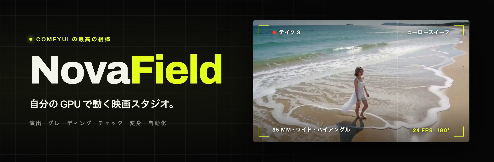
</p>

<p align="center">
  <a href="LICENSE"></a>
  
  
  
</p>

<p align="center">
  <a href="README.md">English</a> · <b>日本語</b> · <a href="README.zh-Hant.md">繁體中文</a>
</p>

<p align="center">
  <a href="#はじめかた">はじめかた</a> ·
  <a href="#novafield-の機能紹介">機能紹介</a> ·
  <a href="#機能ごとに必要なモデル">モデル</a> ·
  <a href="#ai-エージェントと使う">AI エージェント</a> ·
  <a href="docs/technical.ja.md">技術ガイド</a>
</p>

**自分の GPU で動く映画スタジオ。** ショットを書き、撮影監督のようにフレーミングしてレンダリング。
そのままグレーディングし、仕上がりをチェックし、1 本の映画に編集するところまで、すべてブラウザ上のひとつのアプリで完結します。

アプリ本体も、画面上部の言語メニューから日本語に切り替えられます。

<p align="center">
  <a href="docs/media/novafield-promo.mp4">
    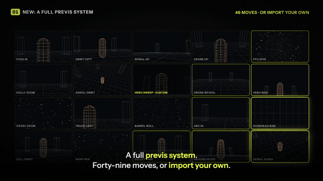
  </a>
  <br>
  <sub>▶ <a href="docs/media/novafield-promo.mp4"><b>90 秒のフル動画を見る</b></a>（音声あり）</sub>
</p>

NovaField は [ComfyUI](https://www.comfy.org/) の上で動きます。ノードを自分でつなぐ必要はありません。
NovaField が ComfyUI のグラフをすべて組み立て、実行前にお使いのサーバーで動くかを確認し、
結果をそのまま作業を続けられる「テイク」として表示します。レンダリングは自分の ComfyUI（自分の GPU で無料）か、
Comfy Cloud（Comfy クレジットで有料）で実行できます。

> グラフのコンパイル、ノードパックの仕様、エージェント API、コード構成など、内部の仕組みを知りたい方は
> [技術ガイド](docs/technical.ja.md)をご覧ください。

## できること

| ページ | 用途 |
|---|---|
| **スタジオ** | ショットを書いて演出します。キャスト、ショットサイズ、アングル、レンズ、カメラワーク、ライティング、フィルムストックを指定し、レンダリング前にライブのプリビズでカメラの動きを確認できます。 |
| **画像** | 生成した静止画、動画のフレーム、手持ちの写真など、どんな画像でも編集・アップスケール・拡張できます。 |
| **変身** | 手元の映像を作り変えます。人物の差し替え、クリップのスタイル変更、物の置き換え、描いたパスに沿って静止画を動かすことができます。 |
| **シーケンス** | テイクを 1 本の映画に編集します。トリム、分割、並べ替え、カットとディゾルブ、MP4 での書き出しに対応しています。 |
| **ライブラリ** | すべてのテイク・画像・クリップを、プロジェクトごとに整理して保管します。 |
| **アセット** | キャラクター、物、場所、スタイル、クリップを登録しておき、どのショットにもすぐ使えます。 |
| **ワークフロー** | どんな ComfyUI ワークフローもシンプルなフォームに変えたり、グラフとして開いたりできます。 |

完成した動画テイクでは、ほかにも **グレード** でフィルムルックを付けたり（**別のショットに合わせる** や、シャッターブラーと速度を調整する **動き** も使えます）、
**ショット QC** で不具合を探したり、**このショットの続きを撮る** を使ったり、変身・画像・シーケンスの編集へ送ったりできます。

## 必要なもの

- **ComfyUI サーバー。** 次のどちらかを用意してください。
  - **自分のサーバー：** このコンピューター、または同じネットワーク上の別のコンピューターで動く ComfyUI（NVIDIA GPU 搭載）。
    動画モデルはサイズが大きいので、VRAM に余裕のあるグラフィックボード（RTX 4090 など）がおすすめです。
  - **Comfy Cloud：** GPU は不要です。Creator プランまたは Pro プランが必要で、レンダリングには Comfy クレジットを消費します。
    Comfy Cloud ではカスタムノードをインストールできないため、NovaField ノードが必要な機能はロックされたままになります。
- **使いたい機能に必要なモデル。** すべてそろえる必要はありません。
  [機能ごとに必要なモデル](#機能ごとに必要なモデル) をご覧ください。
- **NovaField を動かすコンピューターに：** [Node.js](https://nodejs.org/) 22 以降、パッケージマネージャーの `pnpm`、[Git](https://git-scm.com/)、
  `ffmpeg`（`ffprobe` を含む）。NovaField は macOS、Windows、Linux で動作します。

## はじめかた

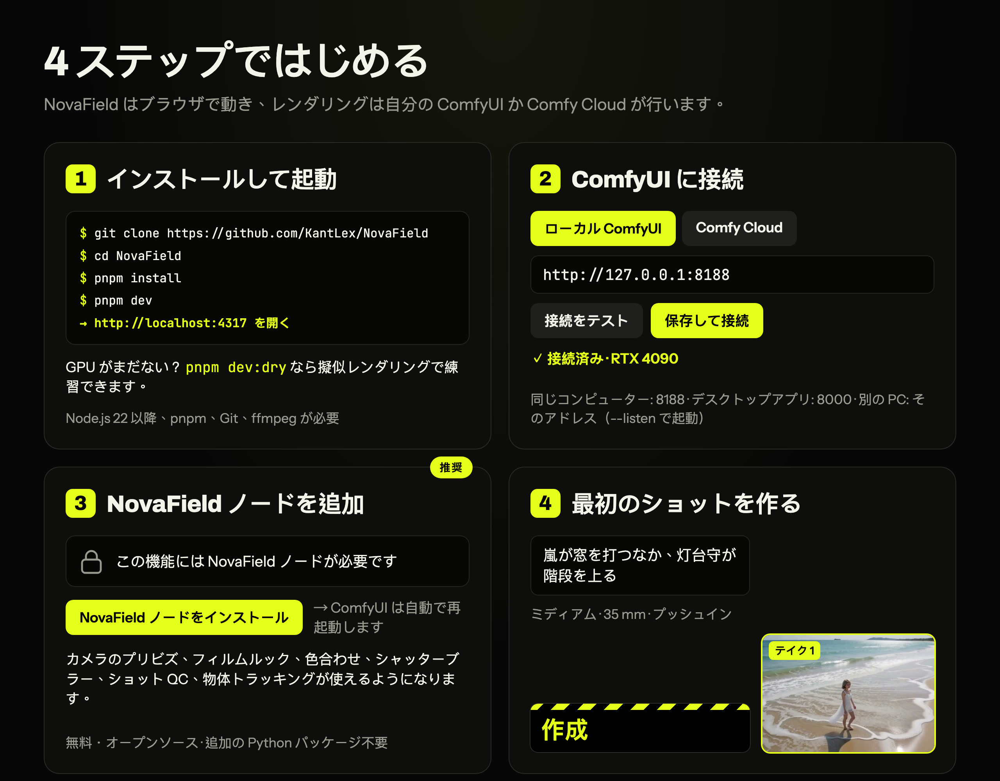

### 1. NovaField をインストールして起動する

NovaField をダウンロードして、そのフォルダに移動します。

```bash
git clone https://github.com/KantLex/NovaField
```

```bash
cd NovaField
```

続けて、インストールして起動します。

```bash
pnpm install
```

```bash
pnpm dev
```

ブラウザで **http://localhost:4317** を開きます。

> `pnpm` が入っていない場合は、Node.js に付属の Corepack を使えます。`corepack enable` を実行するか、
> 各コマンドの前に `corepack` を付けてください（`corepack pnpm install`）。

### 2. ComfyUI に接続する

右上のサーバー状態をクリックして **接続** 画面を開き、次のどちらかを選びます。

- **ローカル ComfyUI：** ComfyUI のアドレスを入力します。
  - **同じコンピューターで動く ComfyUI：** たいていは何も変更する必要はありません。NovaField は ComfyUI の標準アドレスである
    `http://127.0.0.1:8188` を探します（`127.0.0.1` は「このコンピューター」、`8188` は ComfyUI が使うポート番号という意味です）。
    ComfyUI デスクトップアプリはポート 8000 を使うので、`http://127.0.0.1:8000` と入力してください。
  - **別のコンピューターで動く ComfyUI：** そのコンピューターのネットワーク上のアドレスを入力します（例：`http://192.168.1.20:8188`）。
    ComfyUI がほかのコンピューターからの接続を受け付けるよう設定しておく必要があります。`--listen` を付けて起動するか、
    デスクトップアプリで Settings → Server Configuration → Listen address を `0.0.0.0` にして再起動してください。
- **Comfy Cloud：** platform.comfy.org → API keys で取得した API キーを貼り付けます。

**接続をテスト** をクリックし、続けて **保存して接続** をクリックします。設定は NovaField が覚えておきます。

> うまく接続できないときは [ComfyUI に接続できない？](#comfyui-に接続できない) を参照してください。

#### ComfyUI が別のポートを使っている場合

ポートは、アドレスの最後のコロンのあとの番号です。`http://127.0.0.1:8188` なら `8188` です。

1. **ComfyUI のポートを確認する。** ブラウザで ComfyUI を開いてアドレスバーを見るか、ComfyUI を起動した
   ウィンドウを見ます。起動時に `To see the GUI go to: http://127.0.0.1:8188` のような行が表示されます。
2. **ポートを変えるときは ComfyUI 側で変更します**（NovaField は接続するだけです）。
   - **コマンドや `.bat` ファイルで起動する ComfyUI**（ポータブル版・手動インストール）: 起動コマンドの最後に
     `--port` と使いたい番号を追加します。例: `python main.py --listen --port 8189`。
     Windows のポータブル版では、`run_nvidia_gpu.bat` をメモ帳で開き、`.\python_embeded\python.exe`
     で始まる行の最後に ` --port 8189` を追加します。
   - **ComfyUI デスクトップアプリ**: Settings → Server Configuration → **Port** を変更し、ComfyUI を再起動します。
3. **新しいアドレスを NovaField に設定する。** **接続** 画面を開いて **ローカル ComfyUI** を選び、新しいポートを
   含むアドレス（例: `http://127.0.0.1:8189`、別のコンピューターなら `http://192.168.1.20:8189`）を入力して、
   **接続をテスト**、**保存して接続** の順にクリックします。

> **接続画面を使わずに設定する場合:** NovaField フォルダーに `.env.local` というファイルを作り、
> `COMFY_URL=http://127.0.0.1:8189` と書いて NovaField を再起動します。接続画面で保存したアドレスがある場合は、
> そちらが常に優先されます。

#### ポート 4317 が使用中の場合（NovaField 自身のポート）

NovaField 自体は `http://localhost:4317` で開きます。別のポートを使うには、次のように起動します。

```bash
pnpm exec next dev -p 4400
```

その後 **http://localhost:4400** を開きます。コマンドラインツールと AI エージェントは 4317 で NovaField を探すので、
`NOVAFIELD_URL` で新しいアドレスを伝えます。例: `NOVAFIELD_URL=http://localhost:4400 pnpm novafield status`

画面上部の状態表示で、GPU が空いているか、自分のテイクで使用中か、ほかの人のジョブで使用中かがわかります。
NovaField がキャンセルするのは自分のジョブだけなので、共有サーバーでもほかの人と安心して併用できます。

### 3. NovaField ノードをインストールする（推奨）

NovaField ノードパックを入れると、レンダリングされたカメラのプリビズ、フィルムルック、カラーマッチ、シャッターブラー、
ショット QC、オブジェクトトラッキングが使えるようになります。無料のオープンソースで、Python に追加でインストールするものもありません。

- **いちばん簡単な方法：** NovaField でロックされている機能を開き、**NovaField ノードをインストール** をクリックします。
  NovaField が ComfyUI Manager 経由でパックをインストールし、ComfyUI を再起動してくれます。
- **ComfyUI Manager から入れる場合：** **Install via Git URL** を選んで
  `https://github.com/KantLex/ComfyUI-NovaField` を貼り付け、ComfyUI を再起動します。先に Manager のセキュリティレベルを
  下げるよう求められることがあります（Manager → settings）。
- **手動で入れる場合：** ComfyUI の `custom_nodes` フォルダにクローンし、ComfyUI を再起動します。

  ```bash
  git clone https://github.com/KantLex/ComfyUI-NovaField
  ```

**アップデート：** ComfyUI Manager で **Custom Nodes Manager** を開き、**ComfyUI-NovaField** を探して
**Update** をクリックし、ComfyUI を再起動します。機能に「新しい NovaField パックが必要」と表示されたら、この手順のことです。
新しいノードは NovaField が自動で認識するので、アプリ側で変更することはありません。

### 4. 最初のショットを作る

1. **スタジオ** を開き、何が起きるかを書きます。たとえば *「嵐が窓を叩くなか、灯台守が階段を上っていく」* のように。
2. **ショットサイズ**、**レンズ**、**カメラワーク** を選びます。モニターでカメラの動きが再生されるので、
   レンダリングする前にフレーミングを確認できます。
3. **作成** をクリックします。テイクが GPU でレンダリングされ、モニターの下のストリップに並びます。
4. テイクにカーソルを合わせると、次にできることが表示されます。**このショットの続きを撮る**、**グレード**、**ショット QC**、
   **この画像を編集**、**編集の末尾に追加** などです。

## NovaField の機能紹介

### スタジオ：ショットを演出する

<table>
  <tr>
    <td width="50%">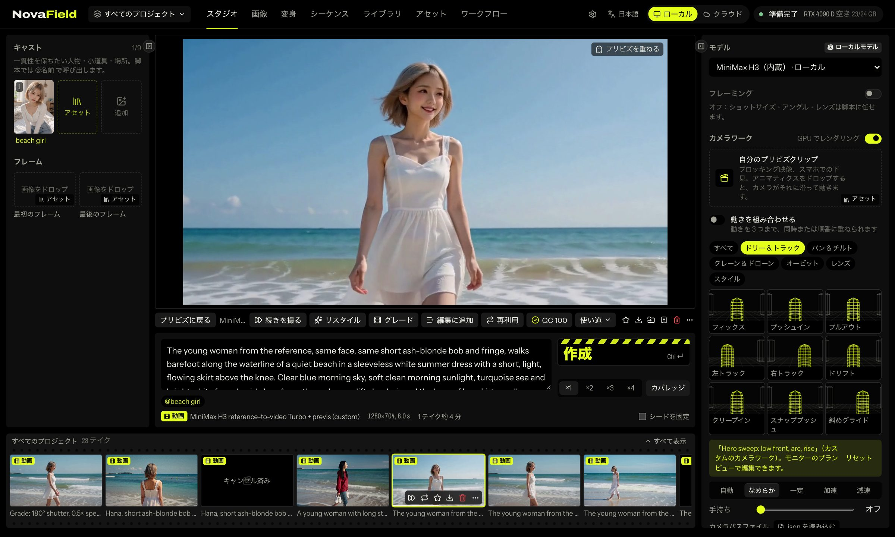</td>
    <td width="50%">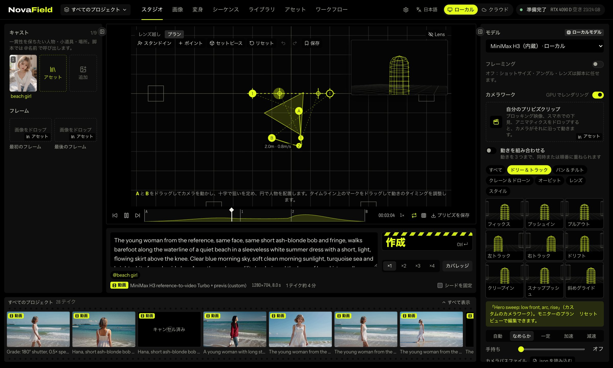</td>
  </tr>
  <tr>
    <td align="center"><sub>レンダリング前に、モニターでカメラの動きを再生できます。</sub></td>
    <td align="center"><sub>プランビュー：真上から動きを形づくります。</sub></td>
  </tr>
</table>

- **脚本とキャスト：** 演技とセリフを書き、参考素材（キャラクター、場所、物）を最大 9 つまで取り込めます。
  `@name` と入力すると、アセットに登録したものを使えます。
- **カメラ：** ショットサイズ、アングル、レンズ、カメラワーク、タイミング（なめらか、一定、加速、減速）、
  手持ちの揺れ、ライティング、フィルムストックを設定できます。
- **テイクとカバレッジ：** 一度に 1〜4 テイクを作成できます。**カバレッジ** を選ぶと、同じ瞬間をワイド・ミディアム・クローズアップの 3 つで撮れます。
- **プランビュー：** 真上から見た見取り図で、カメラの動きを手で形づくれます。
  - **A** と **B** のマークをドラッグしてカメラの始点と終点を決め、ポイントを足して経路を曲げます。照準をドラッグすると向きを変えられます。
  - **スタンドイン**（子どもから長身の大人まで）を最大 3 人置いて、マークの間を歩かせられます。**カメラが追う** をオンにするとトラッキングショットになります。
  - **セットピース**（テーブル、カウンター、車、壁）を置くと、セットに合わせてショットがフレーミングされます。
  - タイムライン上の A・B マークをドラッグすると、カメラがそれぞれの位置に着くタイミングを変えられます。
  - ⌘Z で元に戻す、矢印キーで少しずつ動かす、**保存** で動きをあとで使えるように残せます。
- **自分のプリビズを使う：** ブロックアウト、スマホで撮ったウォークスルー、アニマティックをドロップすると、
  モデルがそのカメラの動きに（必要なら人物の配置や動きにも）沿って生成します。カメラワークは JSON で読み込み・書き出しもでき、
  `samples/blender_export_novafield.py` を使えば Blender からも取り込めます。
- **このショットの続きを撮る：** テイクの最後の数瞬を、動きも音も含めて新しいテイクに引き継ぐので、つなぎ目がわかりません。

### 画像：画像の編集・アップスケール・拡張

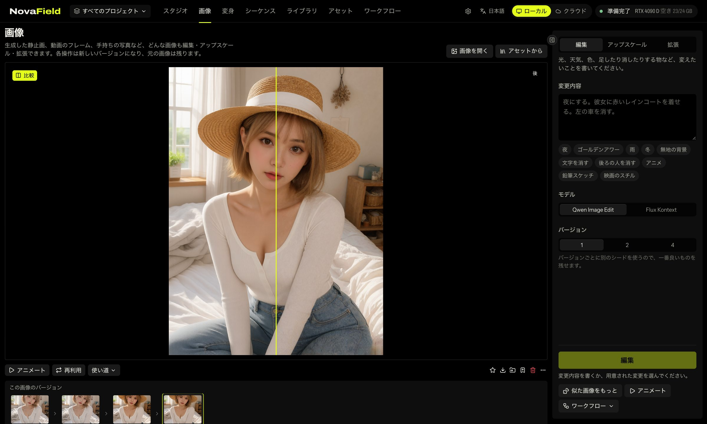

テイク、動画のフレーム、アセット、またはコンピューターから画像を開き、ツールを選びます。

- **編集：** 変えたい内容を言葉で伝えます。*「夜にして」*、*「彼女に赤いレインコートを着せて」*、*「左の車を消して」* など。
  よく使う変更はワンクリックで適用できます：夜、ゴールデンアワー、雨、冬、無地の背景、文字を消す、後ろの人を消す、アニメ、鉛筆スケッチ、映画のスチル。
- **アップスケール：** 画素を引き伸ばすのではなく、細部を新たに描き込みながら 2 倍のサイズにします。
  **創造性** スライダーで、どこまで新しいディテールを加えるかを調整できます。
- **拡張：** フレームを新しい縦横比に広げます。画面の外にあるものはモデルが描き足します。

どの操作でも新しいバージョンが作られ、元の画像はそのまま残ります。**バージョン** の履歴から前の状態に戻れ、
**比較** で前後を見比べられます。**似た画像をもっと** はシードを変えて同じ処理をもう一度実行します。
画像が仕上がったら、**この画像をアニメートする** で最初のフレームとしてスタジオに送れます。

### 変身：映像を作り変える

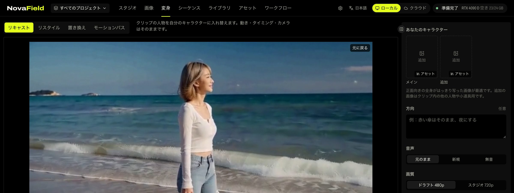

- **リキャスト：** 動きとカメラはそのままに、クリップの人物を自分のキャラクターに差し替えます。
- **リスタイル：** クリップをショットごとに新しいルックで描き直します。
- **置き換え：** いくつかの時点で物を枠で囲むと、NovaField がそれを追跡して別のものに置き換えます。
- **モーションパス：** 静止画に曲線を描くと、その曲線に沿って動きます。パスごとにタイミングを変えたり、
  フレーム全体をカメラのように動かしたりもできます。

### グレード：フィルムルック、色の統一、モーション

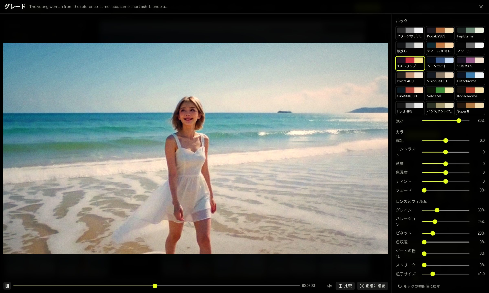

動画テイクで **グレード** を選びます。調整しながらプレビューでグレードがリアルタイムに再生され、
**正確に確認** を押すと一時停止中のフレームを GPU でレンダリングして確かめられます。**クリップに適用** を押すと
グレードを適用した新しいテイクができ、元のテイクはそのまま残ります。

- **ルック：** Kodak 2383 や Fuji Eterna から、Technicolor、CineStill 800T、Kodachrome 64、Ilford HP5、VHS 1989、Super 8 まで、
  18 種類のフィルムストック。強さはスライダーで調整できます。
- **カラー：** 露出、コントラスト、彩度、色温度、ティント、フェード。
- **レンズとフィルム：** グレイン（粒子の大きさも）、ハレーション、ビネット、色収差、ゲートウィーブ、アナモルフィックのストリーク。
- **別のショットに合わせる：** 別のテイクを選ぶと、このクリップがその色合いに寄せられ、ふたつのショットをつないでも色が飛びません。
  **量** で寄せる度合いを決め、**このクリップの明るさを保つ** をオンにすると色だけを合わせます。
- **動き：**
  - **シャッター** で本物のモーションブラーを加えます。180° は映画らしい定番の見え方、45° はキレのあるスタッカート、
    360° は夢のように流れる映像になります。
  - **速度** は 0.5×（なめらかなスローモーション）から 2× まで。速度を変えると音は付きません（映像に追従できないためです）。

グレーディングは NovaField ノードを使って GPU で処理します。AI モデルもクレジットも使いません。

### ショット QC：編集前に不具合を見つける

AI 動画では、映像が止まる、急に揺れる、ちらつく、ぼやけるといったことが起こります。**ショット QC** はテイク全体を
数秒でチェックし、100 点満点でスコアを付けます。チェックする項目は次のとおりです。

| 不具合 | 内容 |
|---|---|
| フリーズしたフレーム | テイクのほかの部分は動いているのに、映像が止まっている。 |
| ジャンプ | あるフレームだけが、前後の動きより大きく揺れたり変形したりしている。 |
| ちらつき | 1 フレームだけ明るさが跳ねる。 |
| ピンボケのフレーム | 数フレームの間ピントが甘くなる。 |
| 白飛び | 明るい部分が真っ白に飛んでいる。 |
| 黒つぶれ | 画面の多くが真っ黒になっている。 |

新しいテイクは、完成すると自動でチェックされます。見直したほうがよいテイク（スコアが 85 未満、または重大な不具合がある）には
バッジが付きます。不具合をクリックすると、テイクのその瞬間にすぐ移動できます。テイクのメニューから **テイクを確認** を
自分で実行することもできます。ショット QC には NovaField ノードが必要で、AI モデルは使いません。

### シーケンス：映画を編集する

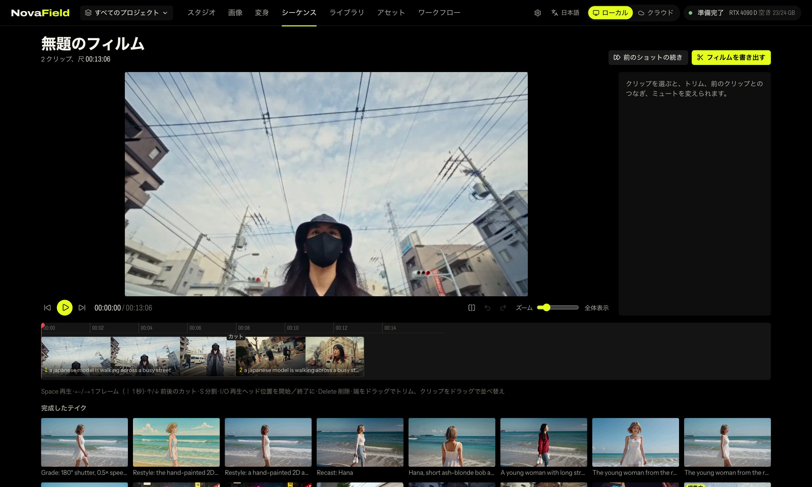

テイクを編集に加えたら、トリム・分割・並べ替えをし、カットやディゾルブでつないで、1 本の MP4 として書き出します。
編集はプロジェクトごとに分かれています。

### ライブラリとアセット

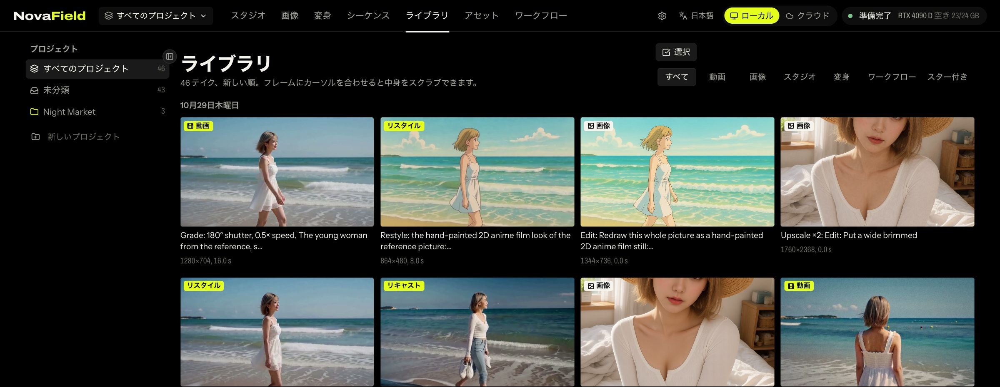

- **ライブラリ：** すべてのテイクが新しい順に、プロジェクトごとに並びます。テイクにカーソルを合わせると中身をスクラブできます。
  開くと、モデルが読んだプロンプトそのものと、実行した ComfyUI グラフを確認できます。
- **アセット：** キャラクター、物、場所、スタイル、クリップを、画像と一緒に一度登録しておけます。あとはワンクリックでショットに取り込んだり、
  `@name` で呼び出したり、ファイルをスタジオ、変身、ワークフローにドロップしたりできます。

### ワークフロー：自分の ComfyUI ワークフローを使う

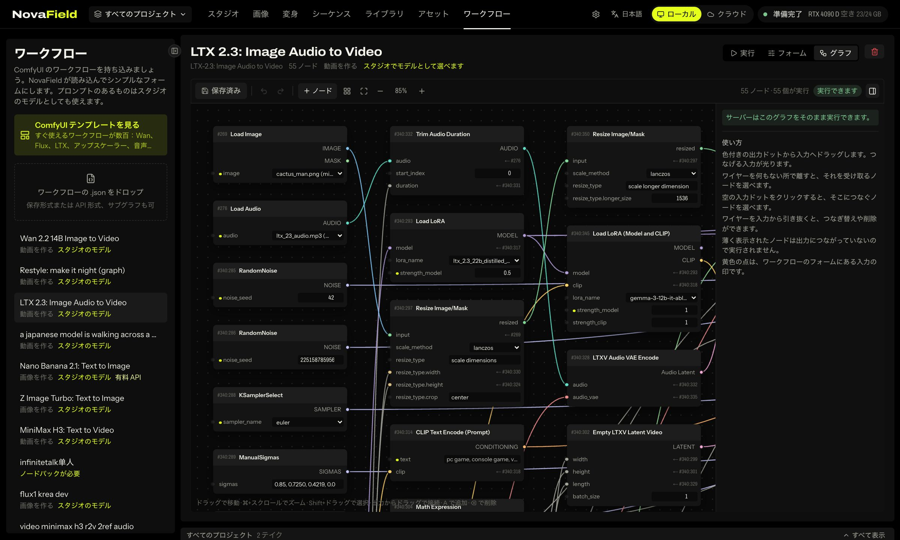

ComfyUI ワークフローの `.json`（サブグラフを含め、どの形式でも可）をドロップするか、ComfyUI に保存してあるものを選ぶか、
ComfyUI のテンプレートから探します。NovaField がそれを読み込み、プロンプト、画像、シード、サイズ、長さ、作者が名前を付けた設定項目からなる
シンプルなフォームを作ります。**フォーム** タブでは、表示する項目を選んだり名前を変えたりできます。

- プロンプトと画像または動画の出力を持つワークフローは、**スタジオのモデル** としても表示されます。
- サーバーに足りないノードがあれば、途中で失敗する代わりに NovaField がその一覧を表示します。
- **グラフモード** では、どのワークフローやテイクも、編集できるノードグラフとして開けます。

### 設定

- **保存場所：** テイク、映画、アップロード、アセットのファイルをどこに保存するかを選べます（容量の大きいドライブなど）。
  NovaField がすべてをコピーし、ファイルを 1 つずつ確認してから切り替えます。削除されるものはありません。
- **接続：** ComfyUI または Comfy Cloud への接続と、API キー。

## 知っておくと便利なこと

- **サイドパネルは折りたためます。** パネルの端にある矢印をクリックするか、**[** で左パネル、**]** で右パネルを
  たたむと、画面を広く使えます。ページごとに状態が保存されます。
- **11 言語に対応：** English、Español、Français、Português、Русский、日本語、한국어、简体中文、
  繁體中文、ไทย、Tiếng Việt。画面上部の言語メニューから選べます。
- **何も捨てません。** グレーディング、編集、アップスケール、続きの撮影では、必ず新しいテイクが作られます。
  元のテイクはそのまま残ります。
- **ロックされた機能は理由を教えてくれます。** サーバーに足りないもの（ノードやモデル）がある場合、
  レンダリング中に失敗する代わりに、何をインストールすればよいかを表示します。
- **GPU なしで練習できます。** `pnpm dev:dry` を使うと、レンダリングをシミュレートした状態で NovaField が動き、
  GPU には何も送られません。

## 機能ごとに必要なモデル

ファイルは ComfyUI のいつものモデルフォルダに置いてください。足りないものがあっても、それを必要とする機能がロックされるだけです。

| 機能 | サーバーに必要なもの |
|---|---|
| スタジオのショット、このショットの続きを撮る | MiniMax H3（両方のモデル、それぞれの Turbo LoRA、Qwen3-VL テキストエンコーダー、動画用と音声用の VAE） |
| 変身：リキャスト、リスタイル、置き換え | Wan 2.1 VACE 14B、`umt5_xxl_fp8`、Wan VAE、CausVid LoRA |
| 変身：モーションパス | Wan 2.1 I2V 480p 14B と `clip_vision_h` |
| 画像：編集と拡張 | Qwen Image Edit または Flux Kontext |
| 画像：アップスケール | Z Image Turbo（`z_image_turbo_bf16`、`qwen_3_4b`、`ae.safetensors`） |
| 48 fps、グレード：シャッターと速度 | FILM フレーム補間（`film_net_fp16`） |
| カメラのプリビズ、グレード、色合わせ、ショット QC、置き換えのトラッキング | NovaField ノードパック（モデルは不要） |

正確なファイル名は [技術ガイド](docs/technical.ja.md#モデル)に載っています。

## AI エージェントと使う

AI エージェントなどの MCP クライアントから NovaField を操作できます。ショットの計画、費用の確認、レンダリング、
テイクの整理、編集、映画の仕上げまで任せられます。アプリを起動した状態で次を実行します。

```bash
pnpm novafield setup
```

エージェントを接続するための正確なコマンドが表示されます。上限を与えない限り、エージェントがクレジットを使うことはありません。
また、エージェントにはまず計画と費用を見せるよう指示してあります。使えるツールの一覧は
[技術ガイド](docs/technical.ja.md#エージェントmcp-サーバーと-cli)にあります。

ターミナルから NovaField のすべてを操作することもできます。ショット、変身、画像、グレード、ショット QC、
ワークフロー、ライブラリ、編集まで対応しています。クレジットの上限を指定するまでは何もレンダリングされないので、
いつでも先に計画と費用を確認できます。

```bash
pnpm novafield --help
```

## トラブルシューティング

### ComfyUI に接続できない？

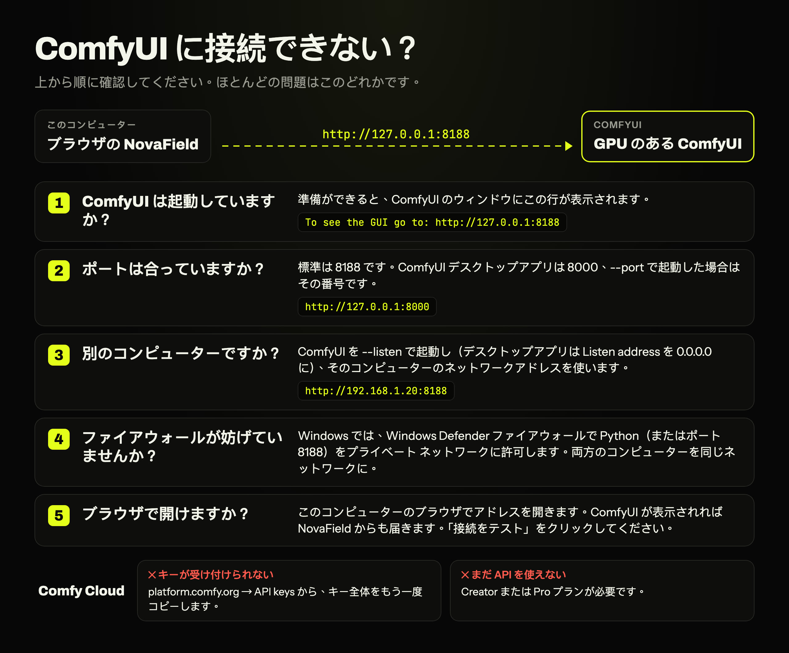

**「No ComfyUI answered at this address」（このアドレスで ComfyUI が応答しない）**
- **ComfyUI は起動していますか？** 準備ができると、ComfyUI のウィンドウに
  `To see the GUI go to: http://127.0.0.1:8188` のような行が表示されます。起動には 1 分ほどかかることがあります。
- **ポートは合っていますか？** 標準は 8188、ComfyUI デスクトップアプリは 8000、`--port` で起動した場合はその番号です。
  [ComfyUI が別のポートを使っている場合](#comfyui-が別のポートを使っている場合) も参照してください。
- **アドレスを最後まで入力しましたか？** `http://127.0.0.1:8188` のように `http://` から入力します。
  「That isn't a web address.」と出たら、どこかが欠けています。

**ComfyUI が別のコンピューターにあり、NovaField から届かない**
1. **`--listen` を付けて起動します。** 付けないと、ComfyUI は自分のコンピューターにしか応答しません。Windows のポータブル版では
   `run_nvidia_gpu.bat` の行の最後に ` --listen` を追加します。デスクトップアプリでは Settings → Server Configuration →
   Listen address を `0.0.0.0` にして再起動します。
2. **`127.0.0.1` ではなく、そのコンピューターのアドレスを使います。** `127.0.0.1` は常に「このコンピューター」を指します。
   Windows では `ipconfig` を実行して IPv4 アドレスを、macOS ではシステム設定 → ネットワークで確認し、
   `http://192.168.1.20:8188` のようにポート付きで入力します。
3. **ファイアウォールを通します。** ComfyUI の起動時に Windows のファイアウォールの確認を閉じてしまった場合は、
   Windows Defender ファイアウォール →「ファイアウォールを経由したアプリを許可」で Python のプライベートにチェックを入れます
   （またはポート 8188 を許可します）。
4. **同じネットワークにつなぎます。** 両方のコンピューターを同じ家庭内ネットワークに。ゲスト Wi-Fi や一部のルーターでは、
   機器同士が見えません。
5. **ブラウザで確認します。** NovaField を動かしているコンピューターのブラウザでアドレスを開きます。そこでも ComfyUI が開かなければ、
   問題は NovaField ではなく 2 台のコンピューターの間にあります。

**レンダリング中に「ComfyUI オフライン」と表示されることがある。** 大きなモデルを読み込んでいる間、ComfyUI は一瞬応答しなくなることがあります。
テイクのレンダリングは続き、表示も自然に戻ります。

**Comfy Cloud**
- **「Comfy Cloud がこのキーを受け付けない」：** platform.comfy.org → API keys からキー全体をもう一度コピーします
  （接続画面の **キーを取得** から開けます）。
- **「このアカウントはまだ Comfy Cloud API を使えない」：** API には Creator または Pro プランが必要です。
- **「このアカウントはまだ Comfy Cloud のウェイトリストにある」：** アカウントが承認されると接続できます。
- **「cloud.comfy.org に接続できない」：** インターネット接続、VPN、プロキシを確認してください。

**「レンダリング中のテイクを待つか、キャンセルしてから切り替えてください」：** テイクのレンダリング中は、ローカルとクラウドを切り替えられません。
終わるのを待つかキャンセルしてから切り替えます。

**接続できたのに機能がロックされたまま。** 接続は問題ありません。サーバーにノードかモデルが足りません。機能を開くと何が足りないか表示されるので、
[NovaField ノードをインストール](#3-novafield-ノードをインストールする推奨)するか、[機能ごとに必要なモデル](#機能ごとに必要なモデル)
からモデルを入れてください。Comfy Cloud にはカスタムノードを入れられないため、それらの機能はロックされたままです。

### その他の問題

- **機能がロックされている：** カーソルを合わせるか開いてみてください。足りないノードやモデルが具体的に表示されます。
- **グレードで「プレビューのみ」と表示される、または「テイクを確認」がない：** サーバーの NovaField パックが古いバージョンです。
  ComfyUI Manager でアップデートし、ComfyUI を再起動してください（[アップデート](#3-novafield-ノードをインストールする推奨) を参照）。
- **GPU が使用中になっている：** 共有サーバーでほかの人のジョブが実行されています。あなたのテイクは順番を待ちます。
  NovaField がほかの人のジョブをキャンセルすることはありません。
- **macOS からリムーバブルボリュームへのアクセスを求められる：** NovaField を外付けドライブに置いている場合は、
  macOS に聞かれたときに Node.js からのアクセスを許可してください。

## ドキュメント

技術ガイド以外のドキュメントは英語です。

- [技術ガイド](docs/technical.ja.md)：NovaField が ComfyUI をどう使っているか、コード構成、テスト、エージェント API。
- [アプリ ⇄ ノードパックの仕様](docs/contract.md)：両者が合意している正確な計算と入力。
- [ノードパック](comfyui-novafield/README.md)：NovaField の全ノードとその入力。
- [ノードパックのリリース手順](docs/releasing-nodes.md)。
- [エージェントスキル](skills/README.md)：ショートドラマ、ミュージックビデオ、広告などを作るための手順集。

## ライセンス

NovaField は [GNU AGPL-3.0](LICENSE) のもとで公開されている無料のオープンソースソフトウェアです。使う、調べる、改変する、共有する、
いずれも自由です。改変したものをほかの人に提供する場合（ホスティングやネットワークサービスとして提供する場合も含みます）は、
同じライセンスでソースコードを公開してください。

クローズドソースの製品やホスティングサービスに組み込むなど、AGPL の義務を負わずに NovaField を使いたい企業は、
商用ライセンスを取得できます。詳しくは [COMMERCIAL.md](COMMERCIAL.md) をご覧ください。コントリビューションは
[CONTRIBUTING.md](CONTRIBUTING.md) の条件のもとで歓迎しています。

`comfyui-novafield/` にある ComfyUI ノードパックは MIT ライセンスです。
