<p align="center">
  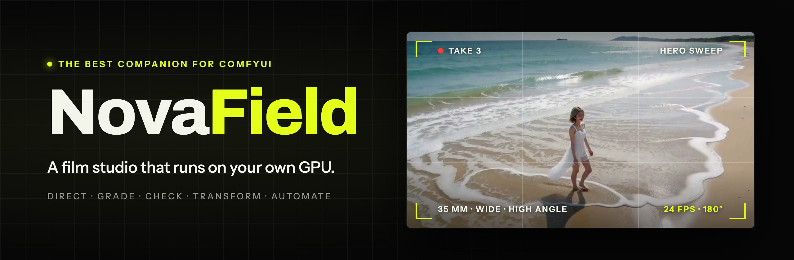
</p>

<p align="center">
  <a href="LICENSE"></a>
  
  
  
</p>

<p align="center">
  <b>English</b> · <a href="README.ja.md">日本語</a> · <a href="README.zh-Hant.md">繁體中文</a>
</p>

<p align="center">
  <a href="#get-started">Get started</a> ·
  <a href="#a-tour-of-novafield">Tour</a> ·
  <a href="#which-models-unlock-what">Models</a> ·
  <a href="#use-it-with-ai-agents">AI agents</a> ·
  <a href="docs/technical.md">Technical guide</a>
</p>

**A film studio that runs on your own GPU.** Write a shot, frame it like a cinematographer, render
it, then grade it, check it and cut it into a film, all in one app in your browser.

<p align="center">
  <a href="docs/media/novafield-promo.mp4">
    
  </a>
  <br>
  <sub>▶ <a href="docs/media/novafield-promo.mp4"><b>Watch the full 90-second video</b></a> (with sound)</sub>
</p>

NovaField works on top of [ComfyUI](https://www.comfy.org/). You don't need to wire nodes yourself:
NovaField builds every ComfyUI graph for you, checks it against your server before it runs, and
shows the result as a take you can keep working on. Renders run on your own ComfyUI (free, on your
GPU) or on Comfy Cloud (paid in Comfy credits).

> Looking for how it works inside: graph compiling, the node pack contract, the agent API and the
> code layout? See the [technical guide](docs/technical.md).

## What you can do

| Page | What it's for |
|---|---|
| **Studio** | Write a shot and direct it: cast, shot size, angle, lens, camera move, light, film stock. Watch the camera move on a live previs before you render. |
| **Image** | Edit, upscale and widen any picture: a generated still, a video frame or your own photo. |
| **Henshin** | Transform footage you already have: swap a person, restyle a clip, replace an object, or animate a still along drawn paths. |
| **Sequence** | Cut takes into a film: trim, split, reorder, cuts and dissolves, export an MP4. |
| **Library** | Every take, picture and clip, sorted into projects. |
| **Assets** | Your characters, objects, places, styles and clips, ready to drop into any shot. |
| **Workflows** | Turn any ComfyUI workflow into a simple form, or open it as a graph. |

On every finished video take you can also **Grade** its film look (with **Match another shot** and
**Motion** for shutter blur and speed), run **Shot QC** to find faults, **Continue this shot**, or
send it to Henshin, Image or the edit.

## What you need

- **A ComfyUI server.** Either:
  - **Your own:** ComfyUI on this computer or another one on your network, with an NVIDIA GPU.
    The video models are large, so a card with plenty of VRAM (such as an RTX 4090) is best.
  - **Comfy Cloud:** no GPU needed. You need a Creator or Pro plan, and renders cost Comfy
    credits. Comfy Cloud can't install custom nodes, so the features that need the NovaField
    nodes stay locked there.
- **The models for the features you want.** You don't need them all; see
  [Which models unlock what](#which-models-unlock-what).
- **On the computer that runs NovaField:** [Node.js](https://nodejs.org/) 22 or newer, the
  `pnpm` package manager, [Git](https://git-scm.com/) and `ffmpeg` (which includes `ffprobe`). NovaField runs on macOS,
  Windows and Linux.

## Get started

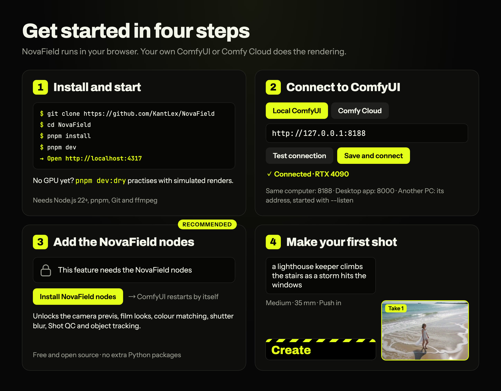

### 1. Install and start NovaField

Download NovaField and go into its folder:

```bash
git clone https://github.com/KantLex/NovaField
```

```bash
cd NovaField
```

Install it and start it:

```bash
pnpm install
```

```bash
pnpm dev
```

Then open **http://localhost:4317** in your browser.

> No `pnpm`? Node.js comes with Corepack: run `corepack enable`, or put `corepack` in front of
> each command (`corepack pnpm install`).

### 2. Connect to ComfyUI

Click the server status at the top right to open the **Connection** screen, and pick one:

- **Local ComfyUI:** enter its address.
  - **ComfyUI on this same computer:** you usually don't need to change anything. NovaField looks
    for it at `http://127.0.0.1:8188`, ComfyUI's standard address (`127.0.0.1` means "this
    computer" and `8188` is the port ComfyUI uses). The ComfyUI desktop app uses port 8000
    instead, so enter `http://127.0.0.1:8000`.
  - **ComfyUI on another computer:** enter that computer's address on your network, for example
    `http://192.168.1.20:8188`. ComfyUI must be set to accept other computers: start it with
    `--listen`, or in the desktop app set Settings → Server Configuration → Listen address to
    `0.0.0.0` and restart it.
- **Comfy Cloud:** paste an API key from platform.comfy.org → API keys.

Click **Test connection**, then **Save and connect**. NovaField remembers it.

> Trouble connecting? See [Can't connect to ComfyUI?](#cant-connect-to-comfyui).

#### If ComfyUI uses a different port

The port is the number after the last colon in the address: `8188` in `http://127.0.0.1:8188`.

1. **Find ComfyUI's port.** Open ComfyUI in your browser and look at the address bar, or look in
   the window where ComfyUI started: it prints a line like
   `To see the GUI go to: http://127.0.0.1:8188`.
2. **To change it, change it in ComfyUI** (NovaField only connects to it):
   - **ComfyUI started from a command or a `.bat` file** (portable or manual install): add
     `--port` and the number you want to the end of the start command, for example
     `python main.py --listen --port 8189`. In the Windows portable version, open
     `run_nvidia_gpu.bat` in Notepad and add ` --port 8189` to the end of the line that starts
     with `.\python_embeded\python.exe`.
   - **ComfyUI desktop app:** Settings → Server Configuration → **Port**, then restart ComfyUI.
3. **Tell NovaField the new address.** Open the **Connection** screen, choose **Local ComfyUI**,
   enter the address with the new port (for example `http://127.0.0.1:8189`, or
   `http://192.168.1.20:8189` for another computer), then click **Test connection** and
   **Save and connect**.

> **Starting NovaField without the Connection screen:** you can put the address in a file named
> `.env.local` in the NovaField folder, as `COMFY_URL=http://127.0.0.1:8189`, and restart
> NovaField. An address saved on the Connection screen always wins over this file.

#### If port 4317 is taken (NovaField's own port)

NovaField itself opens at `http://localhost:4317`. To use another port, start it with:

```bash
pnpm exec next dev -p 4400
```

Then open **http://localhost:4400**. The command-line tool and AI agents look for NovaField at
4317, so tell them the new address with `NOVAFIELD_URL`, for example
`NOVAFIELD_URL=http://localhost:4400 pnpm novafield status`.

The status at the top shows when the GPU is free, busy with your take, or busy with someone
else's jobs. On a shared server NovaField only ever cancels its own jobs, so it's safe to use
alongside other people.

### 3. Install the NovaField nodes (recommended)

The NovaField node pack adds the rendered camera previs, the film looks, colour matching, shutter blur,
Shot QC and object tracking. It's free, open source and needs nothing extra installed in Python.

- **The easy way:** open any locked feature in NovaField and click **Install NovaField nodes**.
  NovaField installs the pack through ComfyUI Manager and restarts ComfyUI for you.
- **Or in ComfyUI Manager:** choose **Install via Git URL** and paste
  `https://github.com/KantLex/ComfyUI-NovaField`, then restart ComfyUI. Manager may ask you to
  lower its security level first (Manager → settings).
- **Or by hand:** clone it into ComfyUI's `custom_nodes` folder and restart ComfyUI:

  ```bash
  git clone https://github.com/KantLex/ComfyUI-NovaField
  ```

**Updating:** in ComfyUI Manager open **Custom Nodes Manager**, find **ComfyUI-NovaField**,
click **Update**, then restart ComfyUI. If a feature says it needs a newer NovaField pack, this is
what it means. NovaField notices the new nodes by itself; there's nothing to change in the app.

### 4. Make your first shot

1. Open **Studio** and write what happens, for example *"a lighthouse keeper climbs the
   stairs as a storm hits the windows"*.
2. Pick a **shot size**, a **lens** and a **camera move**. The monitor plays the move, so you
   see the framing before anything renders.
3. Click **Create**. The take renders on your GPU and lands in the strip under the monitor.
4. Hover the take for what to do next: **Continue this shot**, **Grade**, **Shot QC**, **Edit
   this picture**, **Add to the edit**, and more.

## A tour of NovaField

### Studio: direct a shot

<table>
  <tr>
    <td width="50%">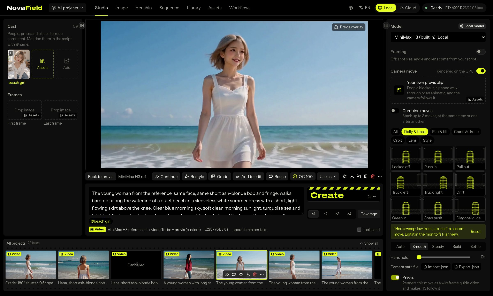</td>
    <td width="50%">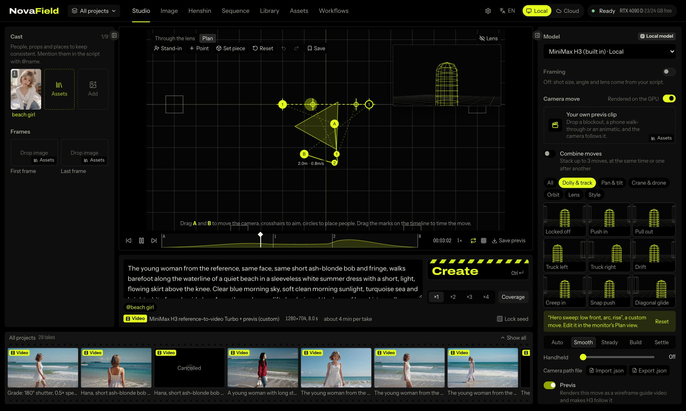</td>
  </tr>
  <tr>
    <td align="center"><sub>The monitor plays the camera move before anything renders.</sub></td>
    <td align="center"><sub>Plan view: shape the move from above.</sub></td>
  </tr>
</table>

- **Script and cast:** write the action and dialogue, and bring in up to 9 references
  (characters, places, objects). Type `@name` to use something from your Assets.
- **Camera:** shot size, angle, lens, camera move, timing (Smooth, Steady, Build, Settle),
  handheld shake, light and film stock.
- **Takes and coverage:** create one to four takes at once, or **coverage**: a wide, a medium
  and a close-up of the same moment.
- **Plan view:** a floor plan seen from above, for shaping a move by hand.
  - Drag the **A** and **B** marks to set where the camera starts and ends, and add points to
    bend its path. Drag the crosshairs to aim.
  - Add up to 3 **stand-ins** (child to tall) who walk between marks; **Camera follows** turns
    it into a tracking shot.
  - Add **set pieces** (tables, counters, cars, walls) so the shot is framed around the set.
  - Drag the A and B marks on the timeline to change when the camera reaches each one.
  - ⌘Z undoes, arrow keys nudge, and **Save** keeps the move for later.
- **Bring your own previs:** drop a blockout, a phone walk-through or an animatic, and the
  model follows its camera (and its blocking if you want). Camera moves also import and export as
  JSON, including from Blender with `samples/blender_export_novafield.py`.
- **Continue this shot:** carries the last moments of a take into a new one, motion and sound
  included, so the join is invisible.

### Image: edit, upscale and widen pictures

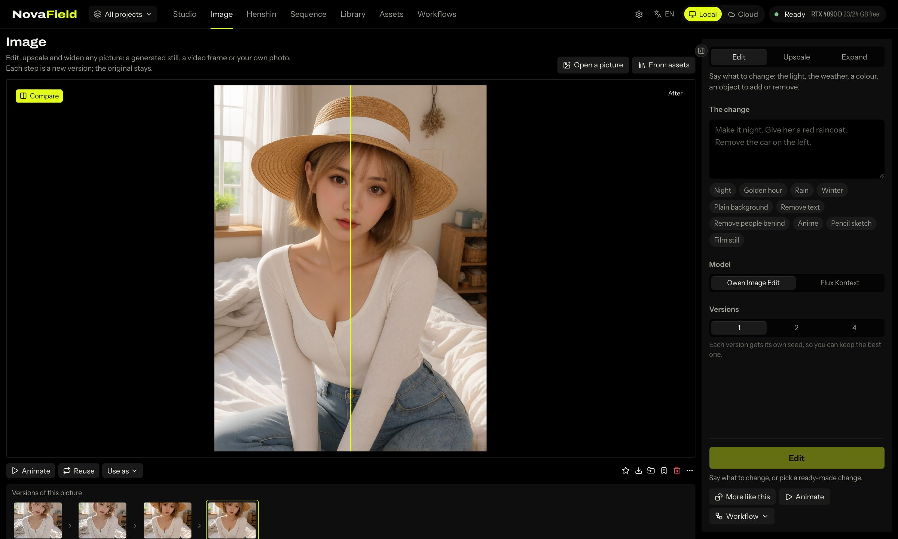

Open a picture from a take, a video frame, your Assets or your computer, then pick a tool:

- **Edit:** say what to change: *"make it night"*, *"give her a red raincoat"*, *"remove the
  car on the left"*. Ready-made changes are one click: Night, Golden hour, Rain, Winter, Plain
  background, Remove text, Remove people behind, Anime, Pencil sketch, Film still.
- **Upscale:** twice the size, with new fine detail drawn in instead of stretched pixels. The
  **Creativity** slider sets how much new detail it may add.
- **Expand:** widen the frame to a new shape; the model paints what lies beyond the edges.

Every step makes a new version and the original stays. The **Versions** trail lets you step back,
and **Compare** shows before and after. **More like this** runs the same job again with a new
seed. When a picture is right, **Animate this picture** sends it to Studio as a first frame.

### Henshin: transform footage

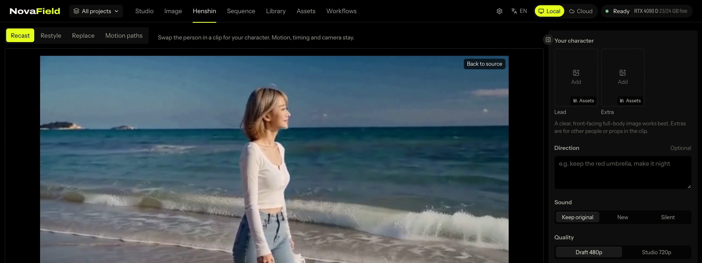

- **Recast:** swap the person in a clip for your character, keeping the motion and camera.
- **Restyle:** re-render a clip shot for shot in a new look.
- **Replace:** draw a box around an object at a few moments; NovaField tracks it and swaps it
  for something else.
- **Motion paths:** draw curves on a still and it moves along them, each path with its own timing,
  or move the whole frame like a camera.

### Grade: the film look, continuity and motion

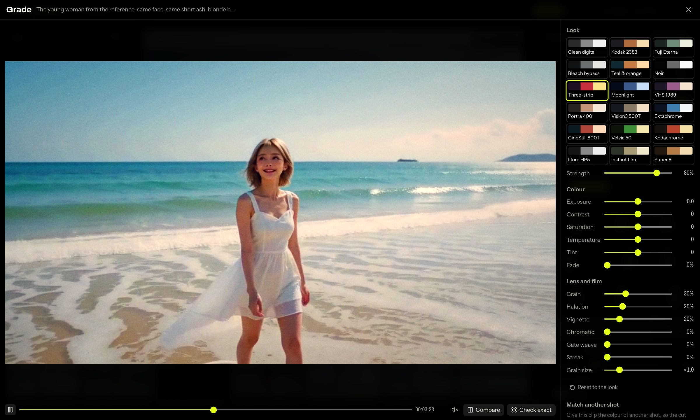

Choose **Grade** on any video take. A preview plays the grade live while you adjust it, and
**Check exact** renders the paused frame on your GPU to confirm it. **Apply to the clip** makes a
new graded take; the original stays.

- **Look:** 18 film stocks, from Kodak 2383 and Fuji Eterna to Technicolor, CineStill 800T,
  Kodachrome 64, Ilford HP5, VHS 1989 and Super 8, with an intensity slider.
- **Colour:** exposure, contrast, saturation, temperature, tint and fade.
- **Lens and film:** grain (and its size), halation, vignette, colour fringing, gate weave and
  anamorphic streaks.
- **Match another shot:** pick another take and this clip takes on its colour, so the cut
  between them doesn't jump. **Amount** sets how far it goes, and **Keep this clip's brightness**
  matches only the colour.
- **Motion:**
  - **Shutter** adds real motion blur. 180° is the classic film look, 45° is crisp and staccato,
    360° smears like a dream.
  - **Speed** from 0.5× (smooth slow motion) to 2×. At a new speed the sound is left out,
    because it can't follow.

Grading runs on your GPU with the NovaField nodes: no AI model and no credits.

### Shot QC: find faults before you cut

AI video sometimes freezes, lurches, flickers or goes soft. **Shot QC** checks a whole take in a
few seconds and gives it a score out of 100. It looks for:

| Fault | What it means |
|---|---|
| Frozen frames | The picture stops while the rest of the take moves. |
| Jump | One frame lurches or morphs much more than the motion around it. |
| Flicker | The brightness pops for a frame. |
| Soft frames | Focus drops for a few frames. |
| Blown highlights | Bright areas are clipped to white. |
| Crushed shadows | Much of the picture is pure black. |

New takes are checked automatically when they finish. A badge appears on any take that needs a
second look (a score under 85, or a serious fault). Click a fault to jump straight to that moment
in the take. You can also run **Check take** yourself from the take's menu. Shot QC needs the
NovaField nodes and uses no AI model.

### Sequence: cut the film

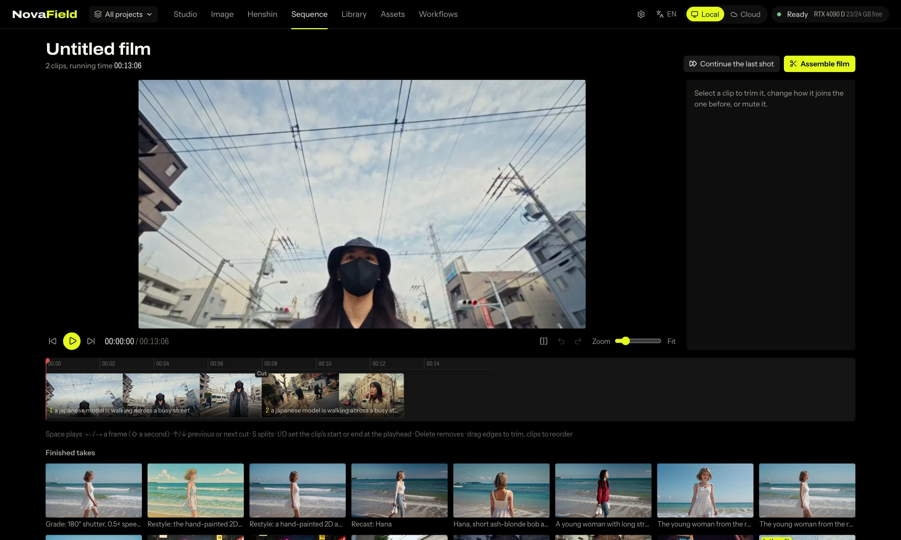

Add takes to the edit, then trim, split and reorder them, join them with cuts or dissolves, and
export one MP4. Each project has its own edit.

### Library and Assets

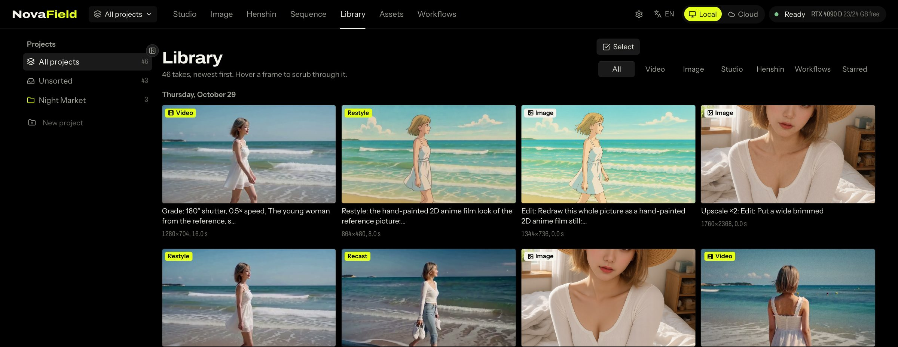

- **Library:** every take, newest first, sorted into projects. Hover a take to scrub through it.
  Open it for the exact prompt the model read and the ComfyUI graph it ran.
- **Assets:** register a character, object, place, style or clip once, with its pictures. Then
  bring it into a shot with one click, mention it as `@name`, or drop its files into Studio,
  Henshin and your workflows.

### Workflows: use your own ComfyUI workflows

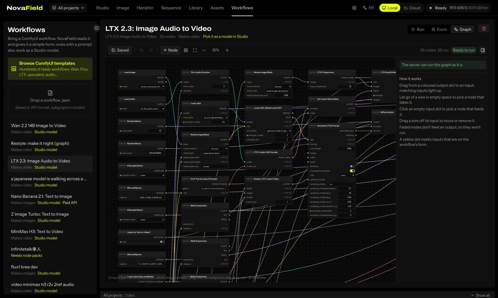

Drop a ComfyUI workflow `.json` (any format, including subgraphs), pick one saved in ComfyUI, or
browse ComfyUI's templates. NovaField reads it and builds a simple form: prompt, images, seed, size,
length, and the settings its author named. The **Form** tab lets you choose what shows and
rename it.

- A workflow with a prompt and an image or video output also appears as a **model in Studio**.
- If your server is missing some of its nodes, NovaField lists them instead of failing halfway.
- **Graph mode** opens any workflow, or any take, as an editable node graph.

### Settings

- **Storage:** choose where your takes, films, uploads and asset files are kept, for example
  on a bigger drive. NovaField copies everything over, checks every file, then switches.
  Nothing is deleted.
- **Connection:** your ComfyUI or Comfy Cloud, and API keys.

## Handy to know

- **Side panels fold away.** Click the arrow on a panel's edge, or press **[** for the left
  panel and **]** for the right one, to give the picture more room. Each page remembers.
- **11 languages:** English, Español, Français, Português, Русский, 日本語, 한국어, 简体中文,
  繁體中文, ไทย and Tiếng Việt. Pick one from the language menu at the top.
- **Nothing is thrown away.** Grading, editing, upscaling and continuing always make a new take.
  The original stays.
- **Locked features tell you why.** If something your server lacks is needed (a node or a model),
  the feature shows what to install instead of failing during a render.
- **Practise without a GPU.** `pnpm dev:dry` runs NovaField with simulated renders, so nothing is
  sent to the GPU.

## Which models unlock what

Put the files in the usual ComfyUI model folders. Anything missing only locks the feature that
needs it.

| Feature | What the server needs |
|---|---|
| Studio shots, Continue this shot | MiniMax H3 (both models, their Turbo LoRAs, the Qwen3-VL text encoder, video and audio VAEs) |
| Henshin: Recast, Restyle, Replace | Wan 2.1 VACE 14B, `umt5_xxl_fp8`, the Wan VAE, the CausVid LoRA |
| Henshin: Motion paths | Wan 2.1 I2V 480p 14B and `clip_vision_h` |
| Image: Edit and Expand | Qwen Image Edit, or Flux Kontext |
| Image: Upscale | Z Image Turbo (`z_image_turbo_bf16`, `qwen_3_4b`, `ae.safetensors`) |
| 48 fps, Grade: Shutter and Speed | FILM frame interpolation (`film_net_fp16`) |
| Camera previs, Grade, Match, Shot QC, Replace tracking | The NovaField node pack (no models needed) |

The exact file names are in the [technical guide](docs/technical.md#models).

## Use it with AI agents

AI agents and other MCP clients can drive NovaField: plan shots, check their
price, render, organise takes, cut the edit and assemble the film. With the app running:

```bash
pnpm novafield setup
```

It prints the exact commands to connect your agent. Agents can't spend credits unless you give
them a ceiling, and they're told to show you the plan and price first. The full list of tools is
in the [technical guide](docs/technical.md#agents-mcp-server-and-cli).

You can also drive all of NovaField from the terminal: shots, Henshin, Image, Grade, Shot QC,
workflows, the library and the edit. Nothing renders until you give a credit ceiling, so you can
always check the plan and price first:

```bash
pnpm novafield --help
```

## Troubleshooting

### Can't connect to ComfyUI?

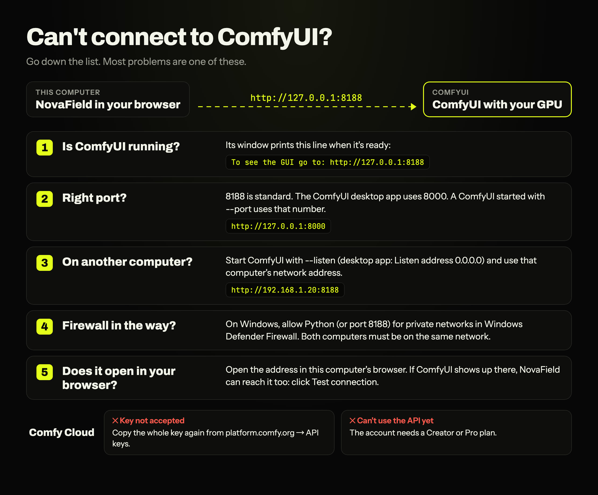

**"No ComfyUI answered at this address."**
- **Is ComfyUI running?** When it's ready, its window prints a line like
  `To see the GUI go to: http://127.0.0.1:8188`. Starting can take a minute.
- **Is the port right?** 8188 is standard; the ComfyUI desktop app uses 8000; a ComfyUI started
  with `--port` uses that number. See [If ComfyUI uses a different port](#if-comfyui-uses-a-different-port).
- **Did you type the whole address?** Include `http://`, as in `http://127.0.0.1:8188`.
  "That isn't a web address." means part of it is missing.

**ComfyUI runs on another computer, and NovaField can't reach it.**
1. **Start it with `--listen`.** Without it, ComfyUI only answers its own computer. In the Windows
   portable version, add ` --listen` to the end of the line in `run_nvidia_gpu.bat`. In the desktop
   app, set Settings → Server Configuration → Listen address to `0.0.0.0` and restart it.
2. **Use that computer's address, not `127.0.0.1`.** `127.0.0.1` always means "this computer". On
   Windows, run `ipconfig` and use the IPv4 Address; on macOS, look in System Settings → Network.
   Then enter it with the port, for example `http://192.168.1.20:8188`.
3. **Let it through the firewall.** If Windows asked about the firewall when ComfyUI started and
   it was dismissed, open Windows Defender Firewall → Allow an app through the firewall, and tick
   Python for Private networks (or allow port 8188).
4. **Use the same network.** Both computers must be on the same home network. Guest Wi-Fi and
   some routers keep devices from seeing each other.
5. **Check in a browser.** Open the address in a browser on the computer that runs NovaField. If
   ComfyUI doesn't open there either, the problem is between the two computers, not in NovaField.

**The status sometimes says "ComfyUI offline" during a render.** While ComfyUI loads a large model
it can stop answering for a moment. The take keeps rendering and the status comes back by itself.

**Comfy Cloud**
- **"Comfy Cloud didn't accept this key."** Copy the whole key again from platform.comfy.org →
  API keys (**Get my key** on the Connection screen opens it).
- **"This account can't use the Comfy Cloud API yet."** The API needs a Creator or Pro plan.
- **"This account is still on the Comfy Cloud waitlist."** You can connect once Comfy lets the account in.
- **"Couldn't reach cloud.comfy.org."** Check your internet connection, VPN or proxy.

**"Wait for the take still rendering, or cancel it, then switch."** NovaField doesn't switch
between Local and Cloud while a take is rendering. Let it finish or cancel it, then switch.

**Connected, but a feature is still locked.** The connection is fine; the server is missing a
node or model. Open the feature to see which, then [install the NovaField nodes](#3-install-the-novafield-nodes-recommended)
or the model from [Which models unlock what](#which-models-unlock-what). Comfy Cloud can't
install custom nodes, so those features stay locked there.

### Other problems

- **A feature is locked:** hover or open it; it says exactly which node or model is missing.
- **"Preview only" in Grade, or no Check take:** the server has an older NovaField pack. Update
  it in ComfyUI Manager and restart ComfyUI (see [Updating](#3-install-the-novafield-nodes-recommended)).
- **The GPU is busy:** someone else's jobs are running on a shared server. Your take waits its turn;
  NovaField never cancels other people's jobs.
- **macOS asks for access to a removable volume:** if NovaField lives on an external drive, allow
  Node.js access to it when macOS asks.

## Documentation

- [Technical guide](docs/technical.md): how NovaField uses ComfyUI, the code layout, testing,
  and the agent API.
- [The app ⇄ node pack contract](docs/contract.md): the exact maths and inputs both sides agree on.
- [The node pack](comfyui-novafield/README.md): every NovaField node and its inputs.
- [Releasing the node pack](docs/releasing-nodes.md).
- [Agent skills](skills/README.md): playbooks for short dramas, music videos, ads and more.

## License

NovaField is free and open source under the [GNU AGPL-3.0](LICENSE): use it, study it, change it and
share it. If you change it and offer it to others, including as a hosted or network service, you
share your source under the same license.

Companies that want to use NovaField without the AGPL's obligations, for example inside a
closed-source product or a hosted service, can get a commercial license. See
[COMMERCIAL.md](COMMERCIAL.md). Contributions are welcome under the terms in
[CONTRIBUTING.md](CONTRIBUTING.md).

The ComfyUI node pack in `comfyui-novafield/` is MIT-licensed.
