<p align="center">
  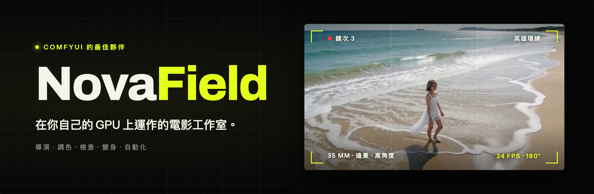
</p>

<p align="center">
  <a href="LICENSE"></a>
  
  
  
</p>

<p align="center">
  <a href="README.md">English</a> · <a href="README.ja.md">日本語</a> · <b>繁體中文</b>
</p>

<p align="center">
  <a href="#開始使用">開始使用</a> ·
  <a href="#novafield-導覽">導覽</a> ·
  <a href="#哪些模型解鎖哪些功能">模型</a> ·
  <a href="#搭配-ai-代理使用">AI 代理</a> ·
  <a href="docs/technical.zh-Hant.md">技術指南</a>
</p>

**在你自己的 GPU 上運作的電影工作室。** 寫下一個鏡頭，像攝影指導一樣構圖，渲染出來，
再調色、檢查、剪成一部片，全部在瀏覽器裡的同一個應用程式中完成。

應用程式本身也能切換成繁體中文：在頂部的**語言**選單選擇「繁體中文」即可。

<p align="center">
  <a href="docs/media/novafield-promo.mp4">
    
  </a>
  <br>
  <sub>▶ <a href="docs/media/novafield-promo.mp4"><b>觀看完整的 90 秒影片</b></a>（有聲音）</sub>
</p>

NovaField 建立在 [ComfyUI](https://www.comfy.org/) 之上，但你不需要自己接節點：
NovaField 會替你建好每一張 ComfyUI 節點圖，在執行前先對照你的伺服器檢查一遍，
再把結果呈現為一個可以繼續加工的鏡次。渲染可以在你自己的 ComfyUI 上進行（免費，使用你的 GPU），
也可以在 Comfy Cloud 上進行（以 Comfy 點數付費）。

> 想了解內部運作方式，例如節點圖編譯、節點包規格、代理 API 和程式碼結構？
> 請參閱[技術指南](docs/technical.zh-Hant.md)。

## 你可以做什麼

| 頁面 | 用途 |
|---|---|
| **攝影棚** | 寫下鏡頭並執導它：角色、景別、角度、鏡頭、運鏡、光線、膠片。渲染之前，就能在即時預演中看到運鏡效果。 |
| **圖片** | 編輯、放大和擴展任何圖片：生成的靜態畫面、影片中的一格，或你自己的照片。 |
| **變身** | 改造你手上已有的影片：替換人物、轉換片段風格、替換物件，或讓靜態圖沿著你畫的路徑動起來。 |
| **序列** | 把鏡次剪成一部片：修剪、分割、重新排序、剪接與溶接，最後匯出 MP4。 |
| **媒體庫** | 所有鏡次、圖片和片段，依專案分類整理。 |
| **素材** | 你的角色、物件、場景、風格和片段，隨時可以放進任何鏡頭。 |
| **工作流程** | 把任何 ComfyUI 工作流程變成簡單的表單，或以節點圖的形式開啟。 |

每個完成的影片鏡次，你都還可以為它**調色**，套上電影質感（搭配**配合另一個鏡頭**，以及調整快門模糊與速度的**動態**），
執行**鏡頭品檢**找出瑕疵、**延續這個鏡頭**，或是把它送到變身、圖片或剪輯中。

## 需要準備什麼

- **一台 ComfyUI 伺服器。** 以下兩種擇一：
  - **你自己的：** 在這台電腦或同一網路中另一台電腦上的 ComfyUI，需配備 NVIDIA 顯示卡。
    影片模型很大，所以 VRAM 越大越好（例如 RTX 4090）。
  - **Comfy Cloud：** 不需要 GPU。你需要 Creator 或 Pro 方案，渲染會消耗 Comfy 點數。
    Comfy Cloud 無法安裝自訂節點，所以需要 NovaField 節點的功能在雲端上會維持鎖定。
- **你想用的功能所需要的模型。** 不必全部都裝，請參閱
  [哪些模型解鎖哪些功能](#哪些模型解鎖哪些功能)。
- **在執行 NovaField 的電腦上：** [Node.js](https://nodejs.org/) 22 或更新版本、
  `pnpm` 套件管理工具、[Git](https://git-scm.com/)，以及 `ffmpeg`（內含 `ffprobe`）。NovaField 可以在 macOS、
  Windows 和 Linux 上執行。

## 開始使用

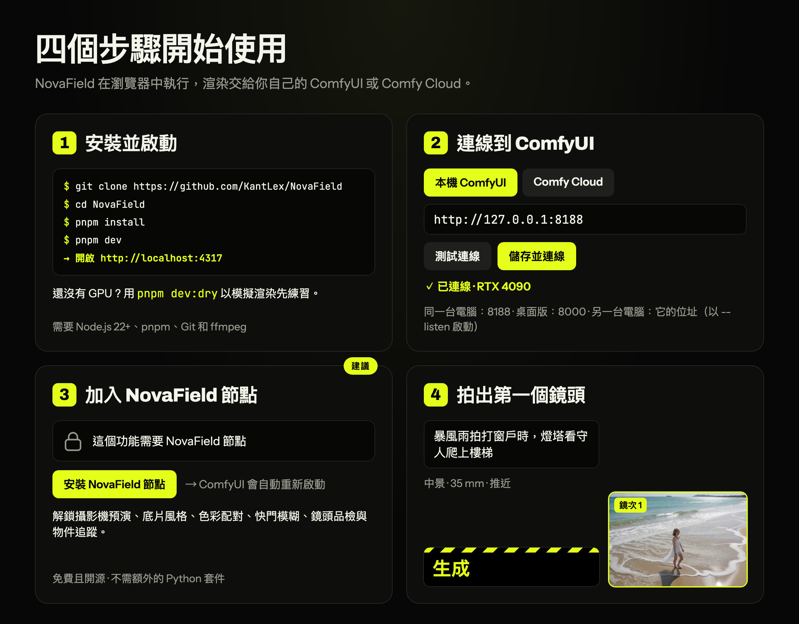

### 1. 安裝並啟動 NovaField

下載 NovaField 並進入它的資料夾：

```bash
git clone https://github.com/KantLex/NovaField
```

```bash
cd NovaField
```

接著安裝並啟動：

```bash
pnpm install
```

```bash
pnpm dev
```

接著在瀏覽器中開啟 **http://localhost:4317**。

> 沒有 `pnpm`？Node.js 內建 Corepack：執行 `corepack enable`，或在每個指令前面加上
> `corepack`（`corepack pnpm install`）。

### 2. 連線到 ComfyUI

點一下右上角的伺服器狀態，開啟**連線**畫面，然後選擇其中一種：

- **本機 ComfyUI：** 輸入它的位址。
  - **ComfyUI 在同一台電腦上：** 通常什麼都不用改。NovaField 會到 `http://127.0.0.1:8188`
    尋找它，這是 ComfyUI 的標準位址（`127.0.0.1` 代表「這台電腦」，`8188` 是 ComfyUI
    使用的連接埠）。ComfyUI 桌面版改用 8000 連接埠，所以請輸入 `http://127.0.0.1:8000`。
  - **ComfyUI 在另一台電腦上：** 輸入那台電腦在網路上的位址，例如
    `http://192.168.1.20:8188`。ComfyUI 必須設定成允許其他電腦連線：啟動時加上
    `--listen`，或在桌面版中把 Settings → Server Configuration → Listen address 設為
    `0.0.0.0`，然後重新啟動。
- **Comfy Cloud：** 貼上從 platform.comfy.org → API keys 取得的 API 金鑰。

點一下**測試連線**，再點**儲存並連線**。NovaField 會記住這個設定。

> 連不上嗎？請參閱[連不上 ComfyUI？](#連不上-comfyui)。

#### 如果 ComfyUI 使用其他連接埠

連接埠就是位址中最後一個冒號後面的數字，例如 `http://127.0.0.1:8188` 的 `8188`。

1. **查出 ComfyUI 的連接埠。** 在瀏覽器開啟 ComfyUI 看網址列，或看啟動 ComfyUI 的視窗：
   啟動時會顯示類似 `To see the GUI go to: http://127.0.0.1:8188` 的一行。
2. **要更改連接埠，請在 ComfyUI 那邊改**（NovaField 只負責連線過去）：
   - **用指令或 `.bat` 檔啟動的 ComfyUI**（可攜版或手動安裝）：在啟動指令最後加上 `--port` 和想用的數字，
     例如 `python main.py --listen --port 8189`。Windows 可攜版請用記事本開啟 `run_nvidia_gpu.bat`，
     在以 `.\python_embeded\python.exe` 開頭的那一行最後加上 ` --port 8189`。
   - **ComfyUI 桌面版**：Settings → Server Configuration → **Port**，改好後重新啟動 ComfyUI。
3. **把新位址告訴 NovaField。** 開啟**連線**畫面，選擇**本機 ComfyUI**，輸入含新連接埠的位址
   （例如 `http://127.0.0.1:8189`；另一台電腦則像 `http://192.168.1.20:8189`），
   再點**測試連線**和**儲存並連線**。

> **不經連線畫面設定：** 在 NovaField 資料夾建立名為 `.env.local` 的檔案，寫入
> `COMFY_URL=http://127.0.0.1:8189`，然後重新啟動 NovaField。若連線畫面已儲存位址，一律以畫面上儲存的為準。

#### 如果 4317 連接埠已被占用（NovaField 自己的連接埠）

NovaField 本身在 `http://localhost:4317` 開啟。要改用其他連接埠，請這樣啟動：

```bash
pnpm exec next dev -p 4400
```

然後開啟 **http://localhost:4400**。命令列工具和 AI 代理預設會到 4317 找 NovaField，
所以請用 `NOVAFIELD_URL` 告訴它們新位址，例如 `NOVAFIELD_URL=http://localhost:4400 pnpm novafield status`。

頂部的狀態會顯示 GPU 目前是空閒、正在處理你的鏡次，還是正在處理別人的工作。
在共用的伺服器上，NovaField 只會取消自己的工作，所以和其他人一起使用也很安全。

### 3. 安裝 NovaField 節點（建議）

NovaField 節點包提供渲染式攝影機預演、電影質感、色彩配合、快門模糊、鏡頭品檢和物件追蹤。
它免費、開放原始碼，而且不需要在 Python 中額外安裝任何東西。

- **最簡單的方法：** 在 NovaField 中開啟任何一個鎖定的功能，點一下**安裝 NovaField 節點**。
  NovaField 會透過 ComfyUI Manager 安裝節點包，並替你重新啟動 ComfyUI。
- **或是在 ComfyUI Manager 中：** 選擇 **Install via Git URL**，貼上
  `https://github.com/KantLex/ComfyUI-NovaField`，然後重新啟動 ComfyUI。Manager 可能會要求你
  先調低它的安全等級（Manager → settings）。
- **或是手動安裝：** 把它 clone 到 ComfyUI 的 `custom_nodes` 資料夾，然後重新啟動 ComfyUI：

  ```bash
  git clone https://github.com/KantLex/ComfyUI-NovaField
  ```

**更新：** 在 ComfyUI Manager 中開啟 **Custom Nodes Manager**，找到 **ComfyUI-NovaField**，
點一下 **Update**，然後重新啟動 ComfyUI。如果某個功能說它需要較新版的 NovaField 節點包，
指的就是這件事。NovaField 會自動偵測到新的節點，應用程式這邊什麼都不用改。

### 4. 拍出你的第一個鏡頭

1. 開啟**攝影棚**，寫下發生的事，例如 *「暴風雨打在窗上，燈塔看守人一步步爬上樓梯」*。
2. 選擇**景別**、**鏡頭**和**運鏡**。監看畫面會播放這個運鏡，讓你在渲染之前就看到構圖。
3. 點一下**生成**。鏡次會在你的 GPU 上渲染，完成後出現在監看畫面下方的列中。
4. 把滑鼠移到鏡次上，就能看到接下來可以做什麼：**延續這個鏡頭**、**調色**、**鏡頭品檢**、
   **編輯這張圖片**、**加入剪輯**等等。

## NovaField 導覽

### 攝影棚：執導一個鏡頭

<table>
  <tr>
    <td width="50%">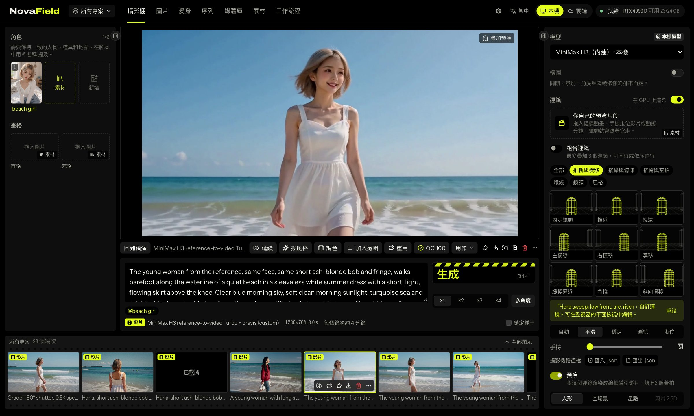</td>
    <td width="50%">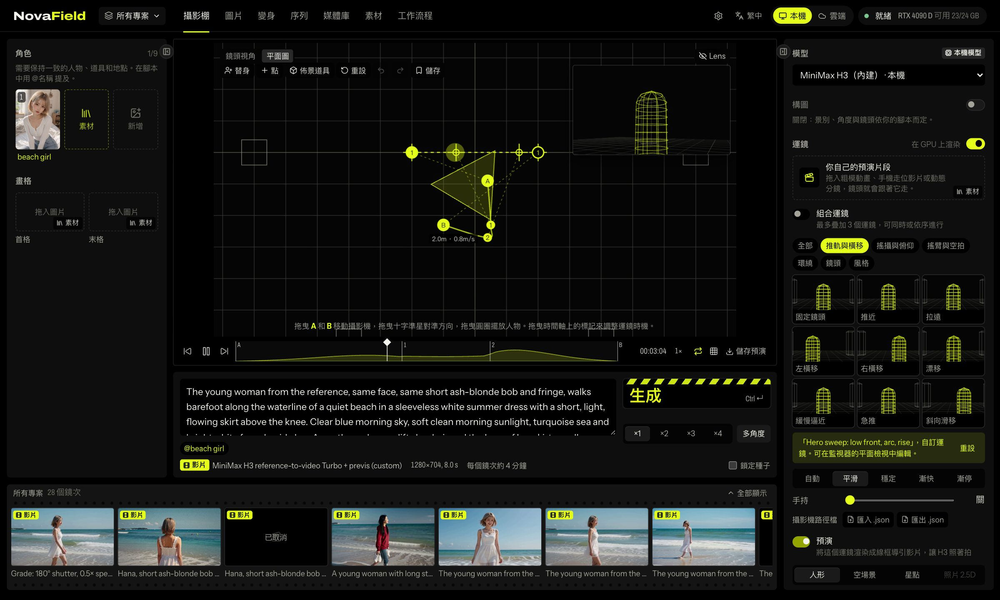</td>
  </tr>
  <tr>
    <td align="center"><sub>渲染之前，監看畫面就會播放運鏡。</sub></td>
    <td align="center"><sub>平面圖：從上方調整運鏡。</sub></td>
  </tr>
</table>

- **腳本與角色：** 寫下動作和對白，並加入最多 9 個參考（角色、場景、物件）。
  輸入 `@name` 即可使用素材中的項目。
- **攝影機：** 景別、角度、鏡頭、運鏡、節奏（平滑、穩定、漸快、漸停）、手持晃動、光線和膠片。
- **鏡次與多角度：** 一次生成一到四個鏡次，或選擇**多角度**：同一時刻的遠景、中景和特寫。
- **平面圖：** 從上方俯視的平面配置圖，讓你親手調整運鏡。
  - 拖曳 **A** 和 **B** 標記，設定攝影機的起點和終點；加入點可以讓路徑彎曲。
    拖曳十字準星可以調整攝影機朝向。
  - 加入最多 3 個**替身**（從孩童到高個子），讓他們在標記之間走動；開啟**攝影機跟隨**，
    就成了跟拍鏡頭。
  - 加入**佈景道具**（桌子、櫃檯、汽車、牆面），讓鏡頭圍繞場景構圖。
  - 在時間軸上拖曳 A 和 B 標記，可以改變攝影機抵達各點的時間。
  - ⌘Z 復原，方向鍵微調，**儲存**可以把運鏡留著以後再用。
- **使用你自己的預演：** 拖入一段 blockout、手機拍的走位影片或動態分鏡，模型就會跟隨它的
  運鏡（需要的話也會照它的走位）。運鏡也能以 JSON 匯入和匯出，包括透過
  `samples/blender_export_novafield.py` 從 Blender 匯出。
- **延續這個鏡頭：** 把一個鏡次最後的片刻帶進新的鏡次，連同動作和聲音一起，讓接點天衣無縫。

### 圖片：編輯、放大和擴展圖片

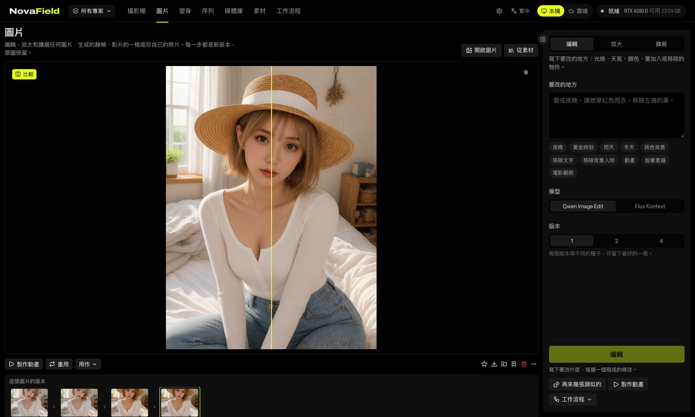

從鏡次、影片畫格、素材或你的電腦開啟一張圖片，然後選擇工具：

- **編輯：** 說出要改什麼：*「改成夜晚」*、*「讓她穿上紅色雨衣」*、*「移除左邊那台車」*。
  也有一鍵套用的現成修改：夜晚、黃金時刻、雨天、冬天、純色背景、移除文字、移除背景人物、
  動畫、鉛筆素描、電影劇照。
- **放大：** 尺寸放大兩倍，並畫出新的細節，而不是單純拉伸像素。
  **創意**滑桿決定它可以加入多少新細節。
- **擴展：** 把畫面擴展成新的比例，模型會畫出邊緣以外的景物。

每一步都會產生新版本，原圖始終保留。**版本**紀錄讓你隨時退回前一步，
**比較**則能顯示修改前後的差別。**再來幾張類似的**會用新的種子再跑一次同樣的任務。
圖片滿意之後，**讓這張圖動起來**會把它當作第一格送到攝影棚。

### 變身：改造影片

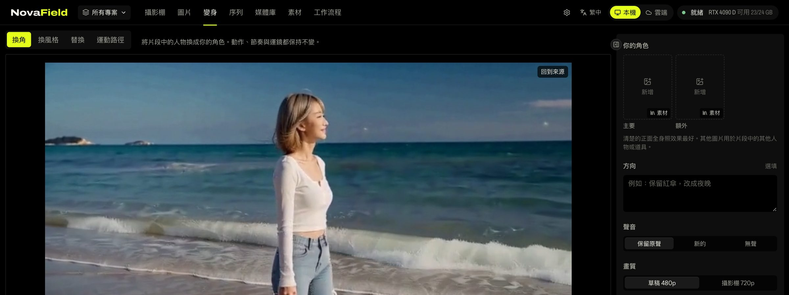

- **換角：** 把片段中的人物換成你的角色，同時保留動作和運鏡。
- **換風格：** 逐鏡頭以新的風格重新渲染片段。
- **替換：** 在幾個時間點框出一個物件，NovaField 會追蹤它，並把它換成別的東西。
- **運動路徑：** 在靜態圖上畫出曲線，畫面就會沿著曲線移動，每條路徑都有自己的時間設定；
  也可以像攝影機一樣移動整個畫面。

### 調色：電影質感、連戲與動態

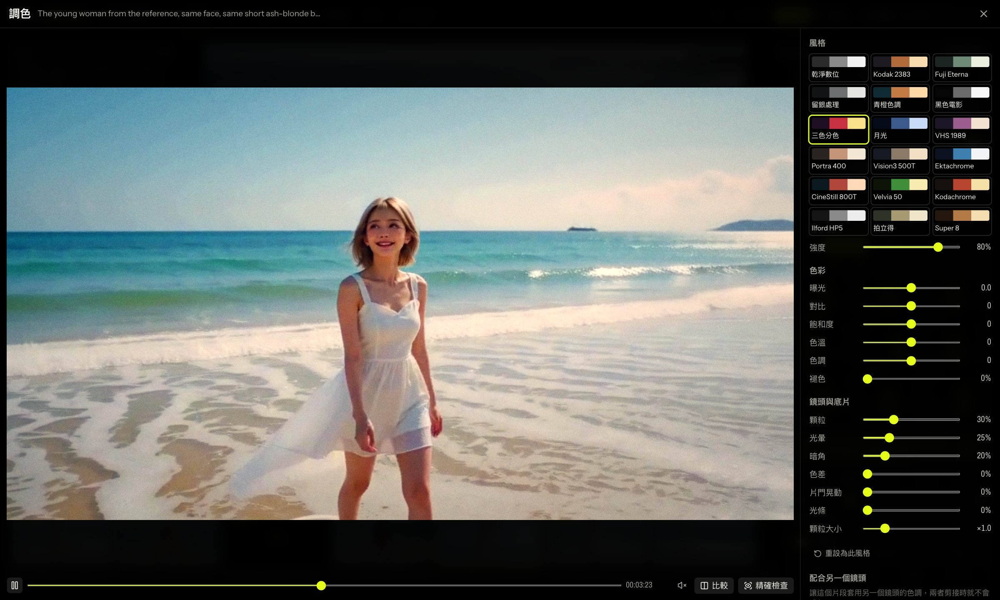

在任何影片鏡次上選擇**調色**。調整時，預覽會即時播放調色效果；
**精確檢查**會在你的 GPU 上渲染暫停的那一格來確認結果。**套用到片段**會產生一個調色後的新鏡次，
原本的鏡次保持不變。

- **風格：** 18 種膠片，從 Kodak 2383、Fuji Eterna 到 Technicolor、CineStill 800T、
  Kodachrome 64、Ilford HP5、VHS 1989 和 Super 8，並附有強度滑桿。
- **色彩：** 曝光、對比、飽和度、色溫、色調和褪色。
- **鏡頭與底片：** 顆粒（以及顆粒大小）、光暈、暗角、色散、片門晃動和變形寬銀幕光條。
- **配合另一個鏡頭：** 選擇另一個鏡次，這個片段就會套用它的色彩，讓兩者之間的剪接不會跳色。
  **強度**決定配合的程度，**保留這個片段的亮度**則只配合色彩。
- **動態：**
  - **快門**會加上真實的動態模糊。180° 是經典的電影感，45° 銳利而有頓挫感，
    360° 則會拖出夢境般的殘影。
  - **速度**可以從 0.5×（流暢的慢動作）調到 2×。改變速度後聲音會被移除，因為它無法跟著變速。

調色透過 NovaField 節點在你的 GPU 上執行：不用 AI 模型，也不花點數。

### 鏡頭品檢：剪接前先找出瑕疵

AI 影片有時會凍結、突然抖動、閃爍或變模糊。**鏡頭品檢**只要幾秒就能檢查完整個鏡次，
並給出 100 分制的分數。它會檢查：

| 瑕疵 | 代表什麼 |
|---|---|
| 凍結畫格 | 鏡次其他部分都在動，畫面卻停住了。 |
| 跳動 | 某一格的抖動或變形遠比前後的動作劇烈。 |
| 閃爍 | 亮度在某一格突然跳動。 |
| 失焦畫格 | 有幾格失焦。 |
| 高光過曝 | 明亮的區域被裁切成純白。 |
| 暗部死黑 | 畫面有一大片是純黑。 |

新的鏡次完成後會自動檢查。需要再看一眼的鏡次（分數低於 85，或有嚴重瑕疵）會出現標記。
點一下瑕疵，就能直接跳到鏡次中的那個時間點。你也可以從鏡次的選單中自己執行**檢查鏡次**。
鏡頭品檢需要 NovaField 節點，不使用任何 AI 模型。

### 序列：剪出整部片

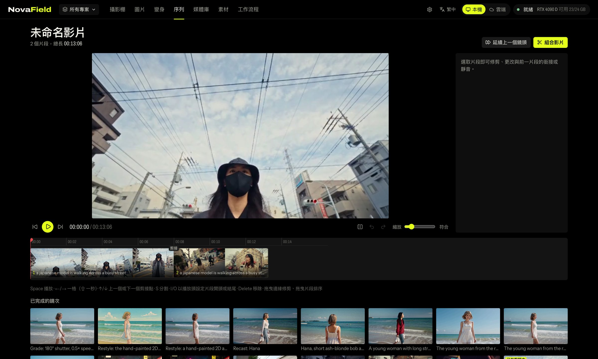

把鏡次加入剪輯，然後修剪、分割、重新排序，用剪接或溶接把它們串起來，最後匯出成一個 MP4。
每個專案都有自己的剪輯。

### 媒體庫與素材

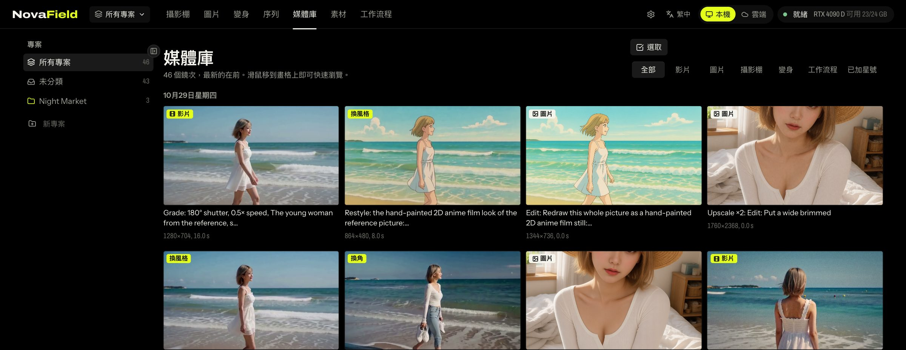

- **媒體庫：** 所有鏡次依專案分類，最新的排在最前面。把滑鼠移到鏡次上即可快速瀏覽。
  開啟鏡次，就能看到模型實際讀到的提示詞，以及它執行的 ComfyUI 節點圖。
- **素材：** 角色、物件、場景、風格或片段只要連同圖片登錄一次，之後就能一鍵放進鏡頭、
  用 `@name` 提及，或把它的檔案拖進攝影棚、變身和你的工作流程中。

### 工作流程：使用你自己的 ComfyUI 工作流程

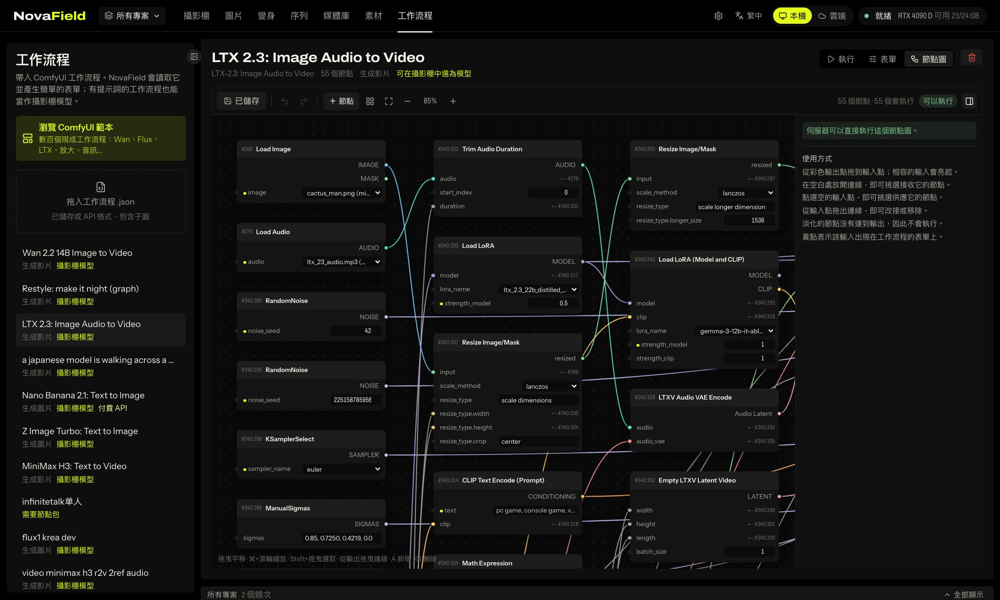

拖入一個 ComfyUI 工作流程 `.json`（任何格式皆可，包含子圖）、挑選一個存在 ComfyUI 中的工作流程，
或瀏覽 ComfyUI 的範本。NovaField 會讀取它並建立一張簡單的表單：提示詞、圖片、種子、尺寸、
長度，以及作者具名的設定。在**表單**分頁中，你可以選擇要顯示哪些項目，並重新命名。

- 有提示詞且輸出圖片或影片的工作流程，也會以**攝影棚中的模型**出現。
- 如果你的伺服器缺少其中某些節點，NovaField 會列出缺少的節點，而不是跑到一半才失敗。
- **節點圖模式**可以把任何工作流程或任何鏡次開啟為可編輯的節點圖。

### 設定

- **儲存空間：** 選擇鏡次、影片、上傳檔案和素材檔案要存放在哪裡，例如更大的硬碟。
  NovaField 會把所有檔案複製過去、逐一檢查，然後才切換過去。不會刪除任何東西。
- **連線：** 你的 ComfyUI 或 Comfy Cloud，以及 API 金鑰。

## 實用小知識

- **側邊面板可以收起來。** 點一下面板邊緣的箭頭，或按 **[** 收起左側面板、按 **]**
  收起右側面板，讓畫面有更多空間。每個頁面都會記住你的設定。
- **11 種語言：** English、Español、Français、Português、Русский、日本語、한국어、简体中文、
  繁體中文、ไทย 和 Tiếng Việt。從頂部的語言選單中挑選即可。
- **什麼都不會丟掉。** 調色、編輯、放大和延續一律會產生新的鏡次，原本的永遠保留。
- **鎖定的功能會告訴你原因。** 如果需要伺服器上沒有的東西（節點或模型），
  功能會直接顯示要安裝什麼，而不是在渲染途中失敗。
- **沒有 GPU 也能練習。** `pnpm dev:dry` 會以模擬渲染執行 NovaField，不會送任何工作到 GPU。

## 哪些模型解鎖哪些功能

把檔案放進 ComfyUI 一般的模型資料夾即可。缺少的模型只會鎖住需要它的功能。

| 功能 | 伺服器需要什麼 |
|---|---|
| 攝影棚鏡頭、延續這個鏡頭 | MiniMax H3（兩個模型、各自的 Turbo LoRA、Qwen3-VL 文字編碼器、影片與音訊 VAE） |
| 變身：換角、換風格、替換 | Wan 2.1 VACE 14B、`umt5_xxl_fp8`、Wan VAE、CausVid LoRA |
| 變身：運動路徑 | Wan 2.1 I2V 480p 14B 和 `clip_vision_h` |
| 圖片：編輯與擴展 | Qwen Image Edit 或 Flux Kontext |
| 圖片：放大 | Z Image Turbo（`z_image_turbo_bf16`、`qwen_3_4b`、`ae.safetensors`） |
| 48 fps、調色：快門與速度 | FILM 插幀（`film_net_fp16`） |
| 攝影機預演、調色、配合、鏡頭品檢、替換追蹤 | NovaField 節點包（不需要模型） |

確切的檔案名稱請見[技術指南](docs/technical.zh-Hant.md#模型)。

## 搭配 AI 代理使用

AI 代理和其他 MCP 用戶端都可以操作 NovaField：規劃鏡頭、查看價格、
渲染、整理鏡次、剪輯並組成整部片。在應用程式執行時，執行：

```bash
pnpm novafield setup
```

它會印出連接代理所需的確切指令。除非你給代理設定點數上限，否則它們無法花費點數；
而且它們會被要求先讓你看過計畫和價格。完整的工具清單請見
[技術指南](docs/technical.zh-Hant.md#代理mcp-伺服器與-cli)。

你也可以從終端機操作 NovaField 的所有功能：鏡頭、變身、圖片、調色、鏡頭品檢、
工作流程、媒體庫和剪輯。在你設定點數上限之前不會渲染任何東西，所以你永遠可以先確認計畫和價格：

```bash
pnpm novafield --help
```

## 疑難排解

### 連不上 ComfyUI？

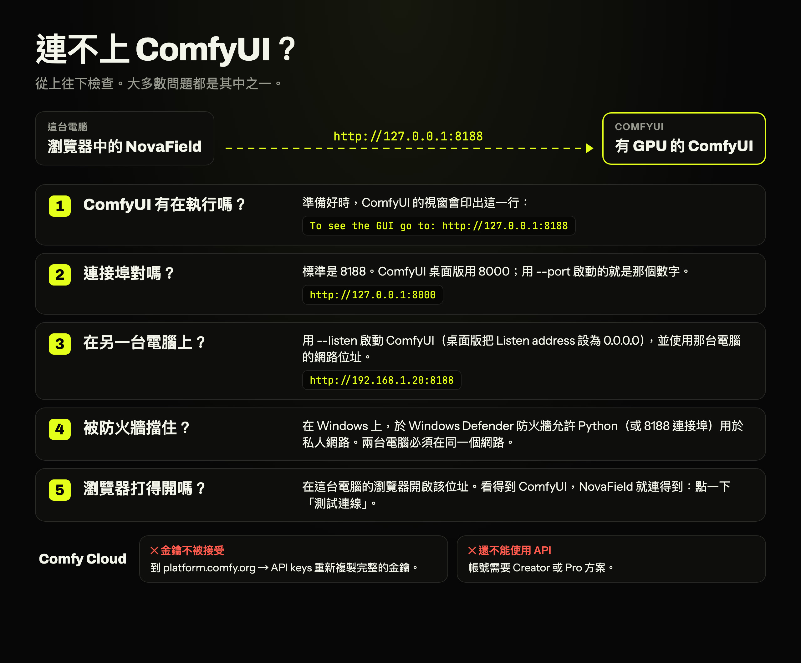

**「No ComfyUI answered at this address」（這個位址沒有 ComfyUI 回應）**
- **ComfyUI 有在執行嗎？** 準備好時，ComfyUI 的視窗會印出類似
  `To see the GUI go to: http://127.0.0.1:8188` 的一行。啟動可能要一分鐘左右。
- **連接埠對嗎？** 標準是 8188；ComfyUI 桌面版用 8000；用 `--port` 啟動的就是那個數字。
  請參閱[如果 ComfyUI 使用其他連接埠](#如果-comfyui-使用其他連接埠)。
- **位址有打完整嗎？** 要從 `http://` 開始，例如 `http://127.0.0.1:8188`。
  出現「That isn't a web address.」表示有部分漏掉了。

**ComfyUI 在另一台電腦上，NovaField 連不到**
1. **用 `--listen` 啟動。** 沒有它，ComfyUI 只會回應自己那台電腦。Windows 可攜版請在 `run_nvidia_gpu.bat`
   那一行最後加上 ` --listen`；桌面版請到 Settings → Server Configuration，把 Listen address 設為 `0.0.0.0` 並重新啟動。
2. **用那台電腦的位址，而不是 `127.0.0.1`。** `127.0.0.1` 永遠代表「這台電腦」。Windows 請執行 `ipconfig`
   查看 IPv4 位址；macOS 請到系統設定 → 網路查看。然後連同連接埠輸入，例如 `http://192.168.1.20:8188`。
3. **讓它通過防火牆。** 如果 ComfyUI 啟動時 Windows 跳出防火牆詢問而被關掉了，請開啟 Windows Defender 防火牆 →
   「允許應用程式通過防火牆」，勾選 Python 的私人網路（或允許 8188 連接埠）。
4. **在同一個網路。** 兩台電腦必須在同一個家用網路。訪客 Wi-Fi 和某些路由器會讓裝置彼此看不到。
5. **用瀏覽器檢查。** 在執行 NovaField 的電腦上用瀏覽器開啟該位址。如果那裡也打不開 ComfyUI，問題出在兩台電腦之間，而不是 NovaField。

**渲染時狀態有時顯示「ComfyUI 離線」。** ComfyUI 載入大型模型時可能會短暫沒有回應。鏡次會繼續渲染，狀態也會自己恢復。

**Comfy Cloud**
- **「Comfy Cloud 不接受這個金鑰」：** 到 platform.comfy.org → API keys 重新複製完整的金鑰
  （連線畫面上的**取得我的金鑰**會直接開啟該頁）。
- **「這個帳號還不能使用 Comfy Cloud API」：** API 需要 Creator 或 Pro 方案。
- **「這個帳號還在 Comfy Cloud 候補名單中」：** 帳號獲准後就能連線。
- **「無法連到 cloud.comfy.org」：** 請檢查網路連線、VPN 或 Proxy。

**「請等待正在渲染的鏡次，或取消它，再切換」：** 有鏡次正在渲染時，NovaField 不會在本機與雲端之間切換。
等它完成或取消後再切換。

**已連線，但功能仍被鎖定。** 連線沒問題，是伺服器缺少某個節點或模型。開啟該功能就會看到缺什麼，然後
[安裝 NovaField 節點](#3-安裝-novafield-節點建議)，或依[哪些模型解鎖哪些功能](#哪些模型解鎖哪些功能)安裝模型。
Comfy Cloud 無法安裝自訂節點，所以那些功能在雲端會維持鎖定。

### 其他問題

- **某個功能被鎖定：** 把滑鼠移上去或開啟它，它會明確告訴你缺少哪個節點或模型。
- **調色中顯示「僅預覽」，或沒有檢查鏡次：** 伺服器上的 NovaField 節點包是舊版。
  請在 ComfyUI Manager 中更新，然後重新啟動 ComfyUI（請參閱[更新](#3-安裝-novafield-節點建議)）。
- **GPU 正在忙：** 共用伺服器上正在執行別人的工作。你的鏡次會排隊等候；
  NovaField 絕不會取消別人的工作。
- **macOS 要求存取卸除式磁碟區：** 如果 NovaField 放在外接硬碟上，macOS 詢問時請允許
  Node.js 存取它。

## 文件

- [技術指南](docs/technical.zh-Hant.md)：NovaField 如何使用 ComfyUI、程式碼結構、測試，以及代理 API。

以下文件目前只有英文版。

- [應用程式 ⇄ 節點包規格](docs/contract.md)：雙方約定的確切數學與輸入。
- [節點包](comfyui-novafield/README.md)：每個 NovaField 節點及其輸入。
- [發布節點包](docs/releasing-nodes.md)。
- [代理技能](skills/README.md)：短劇、音樂影片、廣告等題材的操作手冊。

## 授權

NovaField 是以 [GNU AGPL-3.0](LICENSE) 授權的免費開放原始碼軟體：你可以使用、研究、修改並分享它。
如果你修改了它並提供給他人使用（包括以託管服務或網路服務的形式），就必須以相同的授權條款公開你的原始碼。

想在不受 AGPL 義務約束的情況下使用 NovaField 的公司（例如用在閉源產品或託管服務中），
可以取得商業授權。請參閱 [COMMERCIAL.md](COMMERCIAL.md)。歡迎依照
[CONTRIBUTING.md](CONTRIBUTING.md) 中的條款貢獻。

`comfyui-novafield/` 中的 ComfyUI 節點包採用 MIT 授權。
